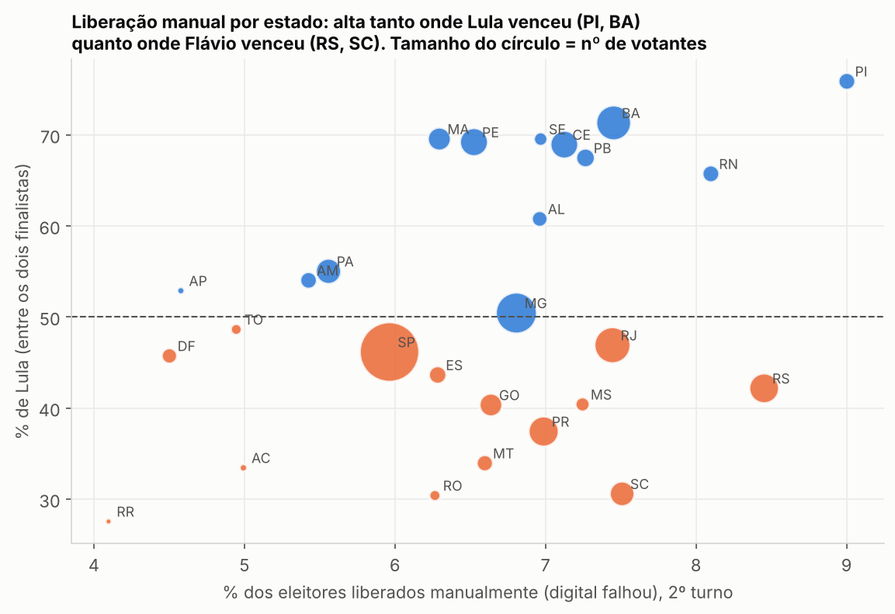
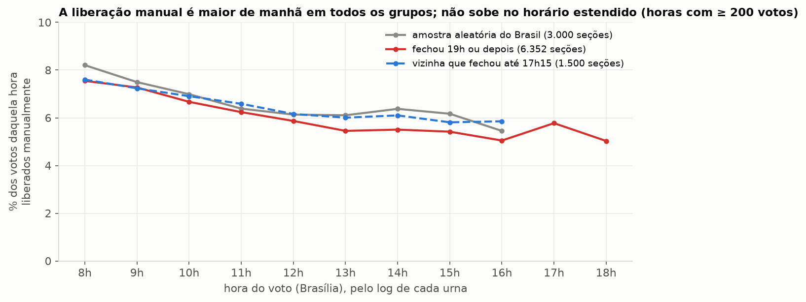
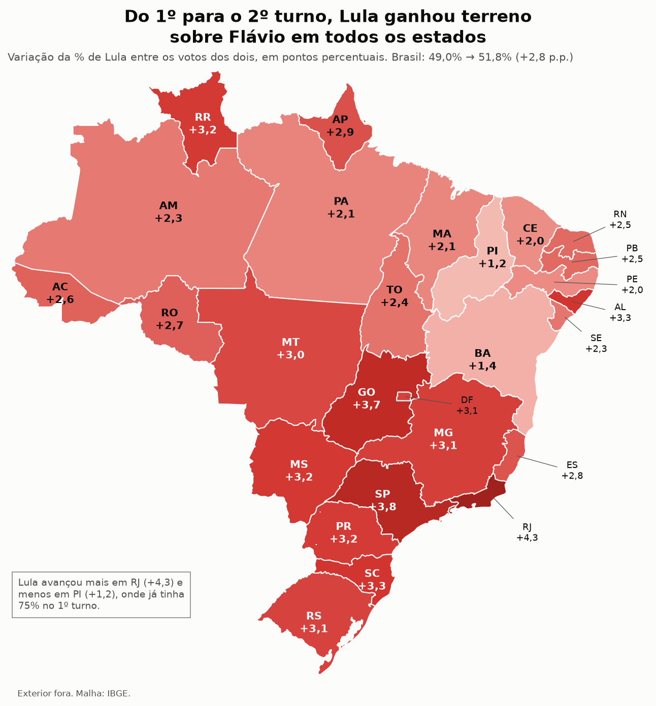
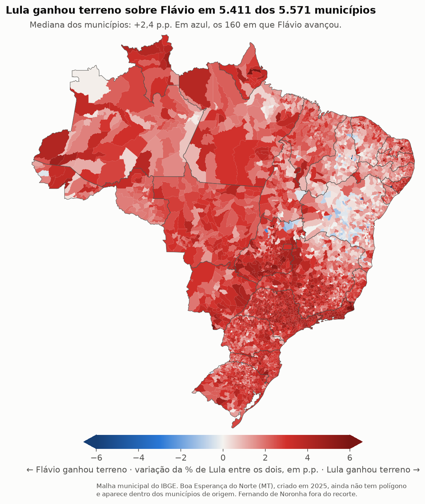
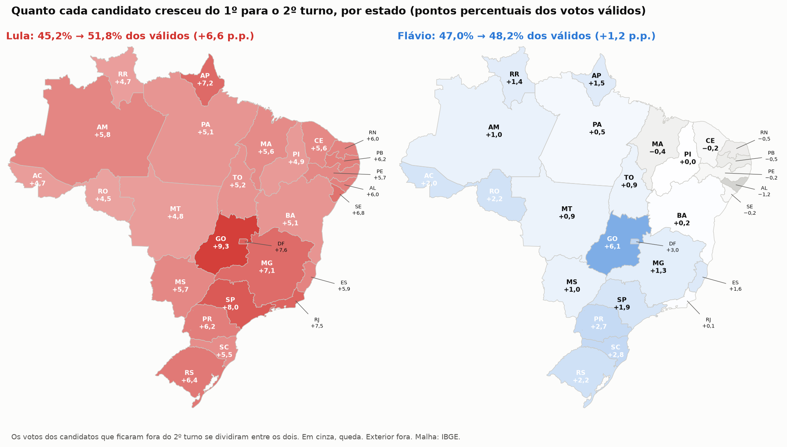

# Auditoria independente da eleição presidencial de 2026
### Independent audit of Brazil's 2026 presidential election

Escolha o idioma / Choose your language: clique para abrir ou fechar cada versão / click to expand or collapse.

<details open>
<summary><b>Português</b></summary>

Conferência, só com dados públicos do TSE, do resultado da eleição para Presidente de 2026 (1º turno em 04/10,
2º turno em 25/10, Lula × Flávio Bolsonaro). Tudo pode ser refeito: os dados estão no repositório (ou se baixam
com um comando) e cada número sai de um script que pode ser lido e rodado. Se você achar um erro, abra uma issue
com o script e o resultado.

O relatório formal, com escopo, metodologia, achados e parecer, está em
[`docs/RELATORIO_DE_AUDITORIA.md`](docs/RELATORIO_DE_AUDITORIA.md).

## Sumário

1. [Introdução](#1-introdução)
2. [As hipóteses, uma por uma](#2-as-hipóteses-uma-por-uma)
3. [Conclusão](#3-conclusão)
4. [Extra: como o voto mudou do 1º para o 2º turno](#4-extra-como-o-voto-mudou-do-1º-para-o-2º-turno)
- [Apêndice A. Glossário](#apêndice-a-glossário)
- [Apêndice B. De onde veio cada dado](#apêndice-b-de-onde-veio-cada-dado)
- [Apêndice C. Problemas nos dados](#apêndice-c-problemas-nos-dados)
- [Apêndice D. Como rodar tudo](#apêndice-d-como-rodar-tudo)
- [Apêndice E. Mapa do repositório](#apêndice-e-mapa-do-repositório)

---

## 1. Introdução

### Por que esta auditoria

Lula venceu o 2º turno por 4.430.191 votos (51,79% a 48,21%). Logo depois circularam afirmações de fraude que
usavam os próprios dados do TSE: que as urnas fechadas mais tarde teriam virado a eleição, que milhões de eleitores
liberados sem digital decidiram o resultado, que os dados ficaram escondidos por dias. Afirmações feitas com dados
públicos podem ser conferidas com os mesmos dados, e é isso que este trabalho faz.

O método é simples de explicar. Onde dá para contar, conto: somo os boletins de urna, reconto os votos gravados por
cada urna, cruzo arquivos entre si. Onde a pergunta é sobre padrões, comparo cada grupo suspeito com um controle: a
mesma seção no 1º turno, a eleição de 2022 e seções vizinhas da mesma cidade. E para cada suspeita calculo quanto da
margem ela poderia explicar no pior cenário que os dados permitem.

### Resultado oficial

| 1º turno, 04/10/2026 | Votos | % dos válidos |
|---|---|---|
| Flávio Bolsonaro (22) | 56.104.503 | 47,03% |
| Lula (13) | 53.879.538 | 45,16% |
| Augusto Cury (70) | 3.448.569 | 2,89% |
| Renan Santos (14) | 2.675.887 | 2,24% |
| Ronaldo Caiado (55) | 2.605.148 | 2,18% |
| Demais 7 candidatos | 587.143 | 0,49% |
| Válidos | 119.300.788 | |
| Brancos / nulos | 2.300.798 / 3.674.249 (inclui 5.246 nulos técnicos) | |
| Comparecimento | 125.275.835 (78,92% dos aptos) | |

| 2º turno, 25/10/2026 | Votos | % dos válidos |
|---|---|---|
| Lula (13) | 64.256.232 | 51,79% |
| Flávio Bolsonaro (22) | 59.826.041 | 48,21% |
| Margem | 4.430.191 | |
| Brancos / nulos | 1.430.496 / 2.723.305 | |
| Comparecimento | 128.236.074 (80,78% dos aptos) | |

### As hipóteses testadas

Cada hipótese abaixo é uma forma de o resultado estar errado ou ter sido alterado. A seção 2 testa uma por uma.

| | Hipótese | Veredito |
|---|---|---|
| H1 | O resultado oficial não é a soma dos boletins de urna. | Refutada |
| H2 | Os boletins não correspondem ao que as urnas gravaram. | Refutada |
| H3 | Foram usadas urnas diferentes das previstas. | Refutada: 99,4% exatamente as previstas e quase todo o resto com explicação; 17 seções sem explicação nos dados |
| H4 | Houve "duas eleições": Flávio venceu até as 17h e a virada veio depois. | Refutada |
| H5 | As seções que ficaram abertas até as 19h receberam votos a mais. | Refutada; o fechamento às 19h aconteceu |
| H6 | Os 8,6 milhões de eleitores liberados sem digital decidiram a eleição. | Sem sinal disso |
| H7 | Seções com 100% para Lula indicam fraude. | Refutada |
| H8 | A Lei de Benford mostra números inventados. | Sem sinal (teste fraco) |
| H9 | O 2º turno destoa do 1º, seção por seção. | Refutada |
| H10 | Os dados ficaram "trancados" por 72 horas para serem alterados. | Procede em parte quanto ao acesso; refutada quanto à alteração |

### O que mudaria a conclusão

Eu concluiria que houve alteração se aparecesse qualquer um destes sinais: uma UF cuja soma de boletins não batesse
com o resultado oficial; um registro digital do voto diferente do boletim da mesma urna; um log com voto fora do
horário ou com liberações diferentes do boletim; um grupo de seções que se desviasse a favor de um candidato, em
relação ao próprio 1º turno, em todas as formas do modelo, inclusive comparando seções da mesma cidade; boletins de
papel diferentes dos arquivos; assinaturas digitais inválidas. Nenhum dos quatro primeiros apareceu (o terceiro, nos logs lidos). Os dois
últimos não foram testados.

---

## 2. As hipóteses, uma por uma

### H1. O resultado oficial é a soma dos boletins?

Antes de tudo, conferi a "impressão digital" (hash SHA-512) de cada arquivo baixado: bate com a publicada pelo TSE
em 112 de 112. Isso prova que o download está íntegro, mas o hash vem do mesmo servidor dos dados.

Depois, `analise/totalizacao.py` soma seções, aptos, comparecimento, brancos, nulos e votos de cada candidato em
todos os boletins, por UF e no Brasil, e compara com o PDF oficial do TSE. Votos, brancos, nulos e comparecimento
batem exatamente em 29 de 29 regiões (27 UFs, exterior e Brasil), nos dois turnos. Contando também seções e aptos,
batem 27 de 29: a diferença são 1 ou 2 seções do exterior sem nenhum votante (apêndice C, problema 10). O resultado
do 2º turno foi assinado às 23h28 de 25/10.

Cada boletim também foi conferido sozinho (`analise/consistencia.py`, 499.205 boletins):

| Regra | Violações |
|---|---|
| aptos = comparecimento + abstenções | 0 |
| comparecimento ≤ aptos | 0 |
| soma de todos os votos = comparecimento | 0 |
| liberados ≤ comparecimento | 0 |
| abertura < encerramento ≤ impressão do BU | 0 (fora as 27 seções de cédula, sem horário) |
| urna abriu no dia da eleição | 0 |
| comparecimento de Presidente menor que o de Governador | 0 (quem vota em trânsito só vota para Presidente) |
| BU recebido pelo TSE antes de impresso pela urna | 8 seções, no máximo 52 segundos (relógio da urna adiantado) |
| urna preparada no dia da eleição | 5 (urnas substituídas antes da abertura, que abriram atrasadas) |

Veredito: refutada. Detalhes em [`TOTALIZACAO.md`](analise/TOTALIZACAO.md) e
[`CONSISTENCIA.md`](analise/CONSISTENCIA.md).

### H2. Os boletins correspondem ao que as urnas gravaram?

Cada urna grava, além do boletim, o registro digital do voto (RDV): cada voto digitado, embaralhado. Escrevi um
leitor desse formato (ASN.1/DER), contei os votos de Presidente um a um em todas as urnas do país e comparei com a
planilha do TSE (`analise/recontagem_rdv.py` e `recontagem_rdv_nacional.py`). Cada RDV foi lido direto do pacote
oficial, baixando só aquele arquivo.

| Recontagem pelo RDV | Resultado |
|---|---|
| Seções com urna eletrônica recontadas (Brasil e exterior) | 499.178 |
| RDV idêntico à planilha (Lula, Flávio, brancos e nulos) | 499.178 de 499.178 |
| Lula / Flávio somando os RDVs | 64.255.787 / 59.825.688 |
| Diferença para o oficial | 445 / 353, exatamente os votos das 27 seções do exterior apuradas em cédula, cujo arquivo o leitor não interpreta |

Em AC, RR e AP (5.703 urnas) li o pacote inteiro: o boletim digital (`bu.dat`), o código de carga, a imagem do
boletim (`imgbu.dat`, o texto que a urna manda imprimir, que vem no mesmo pacote) e o log de cada urna. Tudo bate
com a planilha em 5.703 de 5.703, e nenhum voto foi registrado depois do fechamento.

O RDV é gravado pela mesma urna que gera o boletim, então os arquivos publicados de cada urna contam a mesma história
que a totalização. Como as assinaturas digitais não foram conferidas, isso ainda não prova que são os mesmos arquivos
que saíram da urna, nem que o software é honesto (seção 3).

Veredito: refutada. Detalhes em [`RECONTAGEM_RDV_NACIONAL.md`](analise/RECONTAGEM_RDV_NACIONAL.md),
[`RECONTAGEM_RDV.md`](analise/RECONTAGEM_RDV.md), [`LOGS.md`](analise/LOGS.md) e
[`IMAGEM_BU.md`](analise/IMAGEM_BU.md).

### H3. As urnas usadas eram as previstas?

Na véspera, o TSE gera uma lista de qual urna e qual software ("carga") vai em cada seção, mais as urnas reserva
(contingência). `analise/correspondencia.py` compara cada boletim com essa lista, gerada em 24/10 às 12:31:

| Categoria | Seções | Votos | Saldo de Lula |
|---|---|---|---|
| 1. urna e carga exatamente as previstas | 496.138 | 127.447.547 | +4.401.710 |
| 2. urna prevista, carga diferente da lista | 9 | 2.467 | −55 |
| 3. urna de contingência da lista, com a carga da lista | 2.641 | 686.899 | +21.744 |
| 4. urna de contingência da lista, recarregada | 258 | 63.989 | +1.902 |
| 5. urna fora das listas, carregada depois que a lista foi gerada | 45 | 12.032 | +1.968 |
| 6. urna fora das listas, mesmo cartão de carga da urna prevista | 59 | 15.027 | +2.230 |
| 7. urna fora das listas, sem explicação nos dados | 16 | 4.275 | −19 |
| 8. seção fora da lista: exterior, apurada em cédula | 27 | 831 | +92 |
| 9. seção fora da lista, urna de contingência da lista | 11 | 2.719 | +558 |
| 10. seção fora da lista, urna fora das listas | 1 | 288 | +61 |

A maior parte das trocas usou urna de contingência que estava na lista. As categorias 2, 4, 5, 6 e 9 têm
explicação provável nos próprios dados, mas precisam de confirmação nas atas. As categorias 7 e 10 somam 17 seções e
4.563 votos sem nenhuma explicação, com saldo de +42 para Lula. A divisão entre as categorias 5 e 7 depende da hora
de carga comparada com a hora em que a lista foi gerada: com um erro de 1 hora no relógio, as seções sem explicação
seriam entre 14 e 18.

Veredito: refutada. As 17 seções sem explicação não mudam o resultado (4.563 votos) e podem ser esclarecidas pelas atas
(lista em [`secoes_para_documentar.csv`](analise/secoes_para_documentar.csv)).

### H4. Houve "duas eleições", antes e depois das 17h?

A afirmação: nas urnas fechadas até 17h Flávio venceu com 52,39%, e a virada só veio depois.

Os números saem exatos quando se usa o horário como a urna grava: até 17:00:59, 150.771 seções e Flávio com 52,39%;
de 17:01 a 17:15, 339.593 seções e 53,46% para Lula (`analise/suspeitas.py`). O problema é que a urna grava a hora
local. Urnas do Acre, do Amazonas e do Centro-Oeste que fecharam às 17h de Brasília aparecem como 15h ou 16h e caem
no grupo "antes das 17h". A prova principal está em [`FUSO.md`](analise/FUSO.md): as urnas abrem às 06h no Acre, às
07h no Norte e no Centro-Oeste e às 08h no resto, ou seja, todas às 8h de Brasília.

Três coisas mostram que o grupo "até 17h" é geografia:

1. O mesmo corte dá "duas eleições" também em 2022 (Bolsonaro +1,0 milhão "até 17h", e Lula vira depois):


2. Os estados a oeste são 21% das seções do grupo e 83% da vantagem de Flávio nele. Comparando só seções do mesmo
   estado, a diferença cai de −5,9 para −1,4 p.p.; do mesmo município, para −0,2 p.p. E as mesmas seções já
   votavam assim no 1º turno (−5,95 p.p.):


3. Fechar entre 17:01 e 17:15 é o normal: quem está na fila às 17h vota, e a urna fecha depois do último eleitor.
   Essa faixa tem 68% das seções do país.

Veredito: refutada.

### H5. As seções abertas até as 19h receberam votos a mais?

Aqui há um fato real. No 2º turno, 6.352 seções (em horário de Brasília) fecharam às 19h ou pouco depois, 1.993
delas no minuto 19:00 exato. Um pico num minuto só indica um horário-limite marcado; fila daria fechamentos
espalhados. Elas ficam em 1.131 locais de votação, sobretudo em capitais (Rio 1.978 seções, São Paulo 1.481,
Salvador 730). Um pico assim às 19h00 não aparece no 1º turno (237 seções nesse minuto) nem em 2022.


Mas o horário extra quase não teve votos. Li o log de cada uma das 6.352 urnas direto do servidor do TSE: só 4.492
de 1.861.259 votos (0,24%) foram computados depois das 17h, e 3.885 urnas não tiveram nenhum voto depois das 17h15.
O total de votos no log bate com o boletim em 100% das urnas.


Essas seções também votaram como as outras. Comparadas com seções do mesmo local de votação que fecharam às 17h, a
diferença é de −0,06 p.p. na % de Lula e +0,03 p.p. no comparecimento (nos 313 locais em que todas as seções
fecharam às 19h não há vizinha para comparar). Comparadas com o próprio 1º turno, Lula subiu 3,25 p.p. nelas e 3,24
p.p. nas demais seções das mesmas cidades, e nenhuma das seis formas do modelo de H9 dá desvio a favor de Lula
distinguível de zero. O limite superior de 95% na forma mais desfavorável é de 23.360 votos (0,5% da margem).

Mesmo anulando todas essas seções, Lula venceria por 4.244.467 votos. No Rio, que tem mais seções tardias, Flávio
venceu nelas (45,8% para Lula). A afirmação de que "mais de 2 milhões de eleitores" votaram nessas seções conta os
aptos: pelo relógio local eram 2,30 milhões de aptos e 1,86 milhão de votantes.

Veredito: refutada. Por que esses locais ficaram abertos até as 19h os dados não dizem; isso está nos atos dos
TREs. Detalhes em [`LOGS_TARDIAS.md`](analise/LOGS_TARDIAS.md) e [`RESULTADOS.md`](analise/RESULTADOS.md).

### H6. Os eleitores liberados sem digital decidiram a eleição?

Quando a digital do eleitor falha 4 vezes, a urna pede um dado pessoal e depois a digital do mesário. O número
confere: 8.632.488 liberações assim no 2º turno (6,73% do comparecimento). Compará-lo com a margem só faria sentido
se esses eleitores tivessem votado em bloco num candidato. Testei isso de quatro formas.

1. Pior caso aritmético. Se em cada seção todo liberado tivesse votado em Lula e fosse retirado, Flávio venceria
   por 4,19 milhões. É o cenário extremo, sem nenhum teste por trás.

2. Inclinação: quanto a % de Lula muda quando a taxa de liberação muda. Daí sai uma estimativa de como votaram os
   liberados:

| Comparando… | % de Lula entre os liberados (estimativa / limite de 95%) | Margem se os liberados fossem retirados (estimativa / limite de 95%) |
|---|---|---|
| o país todo | 78% / 92% | −0,33 mi / −2,66 mi |
| dentro do estado | 67% / 76% | +1,53 mi / +0,01 mi |
| dentro do município | 54% / 61% | +3,78 mi / +2,58 mi |

   Liberação e voto em Lula são, os dois, maiores no Nordeste e no interior. Comparar o país todo atribui à
   liberação um efeito que é da geografia (a falácia ecológica). Entre seções da mesma cidade, os liberados votam
   quase como os demais. O exterior fica fora desta conta, porque lá não há biometria.

3. Contra o 1º turno. Dado como a própria seção votou no 1º turno, mais liberação vem com menos Lula do que o
   esperado (−0,32 p.p. a cada 10 p.p. de liberação, margem de erro ±0,06), e o aumento da liberação entre os turnos não tem
   efeito (−0,02 p.p., margem de erro ±0,03). Se a liberação tivesse sido usada para pôr votos em Lula, o sinal
   seria o contrário.

4. Estabilidade. A taxa de cada seção se repete entre os turnos (correlação 0,82), vai de 4,1% (RR) a 9,0% (PI) e
   é alta tanto onde Lula venceu (PI 9,0%, RN 8,1%, BA 7,5%) quanto onde Flávio venceu com folga (RS 8,45%, SC
   7,5%, RJ 7,5%). Parece uma característica da seção, talvez ligada à idade do eleitorado e ao estado dos leitores
   biométricos (hipótese não testada aqui).



Também li o log de 10.809 urnas, eleitor a eleitor: as seções das 19h, 1.500 vizinhas e uma amostra aleatória de
3.000 seções. Em 100% delas as liberações no log batem com o boletim. A taxa é maior de manhã e cai ao longo do dia,
e nas seções abertas até as 19h só 245 eleitores foram liberados depois das 17h (0,006% da margem, mesmo que todos
fossem de Lula). Liberações usadas para encher urnas no fim do dia deixariam o padrão oposto.

| Grupo | Votos | % manual no dia | Votos depois das 17h | Liberações manuais depois das 17h |
|---|---|---|---|---|
| Amostra aleatória do Brasil | 771.027 | 6,84% | 193 | 20 |
| Seções que fecharam às 19h | 1.861.259 | 6,35% | 4.492 | 245 |
| Vizinhas que fecharam até 17h15 | 435.553 | 6,66% | 172 | 17 |



Em 16 seções um único mesário liberou 50 ou mais eleitores (máximo de 165, no Rio); vale conferir esses casos nas atas.

Veredito: sem sinal de que a liberação tenha favorecido Lula. Todas as contas de "margem sem os liberados" supõem que
todos os 8,6 milhões seriam votos ilegítimos, e nada nos dados indica isso: cada liberação tem a digital do mesário no
log, a taxa é estável entre os turnos e o log bate com o boletim em 100% das seções lidas. O pior caso aritmético e a
comparação do país todo inverteriam o resultado, mas exigem também voto em bloco ou ignoram a geografia, e os testes
3 e 4 não mostram sinal disso. Como os dados são por seção, não dá para
saber como cada eleitor votou.
Detalhes em [`BIOMETRIA.md`](analise/BIOMETRIA.md).

### H7. Seções com 100% para Lula indicam fraude?

| Eleição | 100% Lula | 100% adversário | >90% Lula | >90% adversário |
|---|---|---|---|---|
| 2º turno 2026 | 106 | 4 | 6.816 | 378 |
| 1º turno 2026 | 81 | 8 | 6.005 | 713 |
| 2º turno 2022 | 143 | 4 | 9.433 | 213 |

As contagens que circularam (106 contra 4) estão certas. Mas 75% das seções com mais de 90% para Lula estão em MA,
BA, PI, PE e CE, onde ele teve entre 69% e 76%, e 2022 tem o mesmo desenho (143 contra 4).

Veredito: refutada. É voto regional.

### H8. A Lei de Benford mostra números inventados?

| Teste | Resultado |
|---|---|
| 1º dígito | Lula e Flávio "falham" do mesmo jeito (dígito 1 em ~61%). É o esperado: o voto de um candidato numa seção fica entre 100 e 199 em 61% dos casos. O teste não serve para votos por seção (Deckert, Myagkov & Ordeshook, 2011). |
| 2º dígito | Média real de 3,858 (Lula) e 3,971 (Flávio). Em 20 eleições honestas simuladas com o mesmo tamanho de seção: 3,865 a 3,873 (Lula) e 3,965 a 3,980 (Flávio). Flávio fica dentro da faixa; Lula, um centésimo abaixo. |
| Último dígito (Beber & Scacco) | Uniforme para os dois, dentro do que o acaso produz (qui-quadrado 5,0 e 12,4, abaixo do limite de 16,9). |

Veredito: sem sinal relevante. A diferença de um centésimo em Lula é pequena demais para um teste que já detecta pouca
coisa; testes de dígitos são um complemento fraco aos testes de contagem.

### H9. O 2º turno destoa do 1º, seção por seção?

A mesma seção, com os mesmos eleitores, votou duas vezes em três semanas. Se urnas tivessem sido manipuladas no 2º
turno, essas seções sairiam do padrão que o 1º turno indicava.

`analise/primeiro_turno.py` usa o 1º turno de cada seção (votos de Lula, de Flávio, dos outros candidatos,
brancos, nulos e abstenção) para prever quanto Lula teria nela no 2º turno. Depois compara o previsto com o real. Para
não depender de uma escolha só, fiz a conta de seis jeitos (comparando o país todo, só dentro de cada estado ou só
dentro de cada cidade, com variações de fórmula). O 1º turno prevê bem o 2º: a previsão erra, em média, uns 2 pontos
por seção, e explica 93% das diferenças entre seções da mesma cidade.


Nenhum grupo suspeito se desvia a favor de Lula. Nas seções das 19h, a diferença entre o real e o previsto fica entre
−0,12 e +0,18 ponto, pequena demais para se distinguir do acaso em qualquer dos seis jeitos. As seções com muita
liberação manual (20% ou mais) ficam abaixo do previsto para Lula em todas as formas (−0,19 a −0,58 p.p.), um desvio pequeno a favor de Flávio, de 3 a 10 mil
votos, que deve vir do perfil dessas seções.

Há 573 seções muito fora do padrão (erro mais de 4 vezes maior que o típico), divididas entre os dois lados; somando só os desvios a favor
de Lula, dá 8.044 votos, e o efeito líquido é de 3.233. O corte em 4 vezes serve para listar casos, não para
testar: com 2 vezes são 22.983 seções e efeito líquido de 52.685 votos a favor de Lula (1,2% da margem). Lista em
[`secoes_fora_do_padrao_1t_2t.csv`](analise/secoes_fora_do_padrao_1t_2t.csv).

Este teste não pega tudo. Uma manipulação igual em todas as seções passaria por ele: se tivesse acontecido depois da
urna, apareceria na soma oficial e na recontagem do RDV (H1 e H2); se tivesse acontecido dentro da urna, RDV, boletim
e log sairiam coerentes entre si, e só a auditoria do software poderia pegá-la. Ele também não vê manipulação que
tenha ocorrido igual no 1º turno.

Veredito: refutada. Detalhes em [`PRIMEIRO_TURNO.md`](analise/PRIMEIRO_TURNO.md).

### H10. Os dados ficaram "trancados" por 72 horas?

| Evento | Quando |
|---|---|
| Resultado oficial assinado (totalização) | 25/10, 23h28 |
| Planilha BWeb gerada | 26/10, 07h42 |
| BWeb no servidor (data informada pelo servidor) | 26/10, por volta das 09h00 de Brasília; o arquivo do exterior, às 16h49 |
| Arquivos originais das urnas no servidor | 26/10, entre 15h26 e 17h01 de Brasília |
| BWeb listada no catálogo do portal | 27/10, por volta das 19h no relógio do catálogo |

Os arquivos estavam no servidor cerca de 1 dia depois da eleição, mas só apareceram no catálogo, que é onde as
pessoas procuram, cerca de 2 dias depois, e em 29/10 já tinham saído dele de novo.

Veredito: procede em parte. A crítica de que os dados demoraram a ficar acessíveis tem fundamento. A de que estavam
escondidos para serem alterados não encontra apoio: os arquivos batem com o resultado assinado às 23h28 do dia 25. A
conferência de fora seria com os boletins de papel afixados nas seções, que não foram comparados aqui.

---

## 3. Conclusão

Os dados públicos do TSE não mostram sinal de que o resultado do 2º turno tenha sido fabricado ou alterado. O
resultado oficial é a soma exata dos boletins, os boletins batem voto a voto com os registros publicados de cada urna, e nenhum
grupo de seções suspeito se afasta a favor de Lula do que o próprio 1º turno indicava. Quase todos os números das
suspeitas se reproduzem; o erro está na leitura: relógio local tomado por Brasília, regiões misturadas, aptos contados
como votantes e grandezas que não se comparam.

Quanto cada suspeita poderia pesar, no cenário considerado:

| Suspeita | Votos | % da margem |
|---|---|---|
| Anular todas as seções que fecharam às 19h | 185.724 | 4,2% |
| Seções das 19h: limite de 95% do desvio em relação ao 1º turno | 23.360 | 0,5% |
| Seções muito fora do padrão 1º → 2º turno (só desvios a favor de Lula) | 8.044 | 0,2% |
| Seções com urna sem explicação nos dados (todos os votos) | 4.563 | 0,1% |
| Seções das 19h: todos os votos dados depois das 17h | 4.492 | 0,1% |
| Liberação manual, limite de 95% comparando dentro do município | margem cairia para 2,58 mi | 42% |
| Liberação manual, pior caso aritmético (todo liberado votou em Lula) | margem viraria −4,19 mi | 195% |


A liberação manual é a única suspeita com cenários que invertem o resultado, e todos eles supõem que os liberados
votaram em bloco ou que a geografia não explica a relação. Os testes contra o 1º turno (H6, itens 3 e 4) não mostram
sinal de nenhuma das duas coisas.

Continua em aberto, e não foi testado:

- As assinaturas digitais dos arquivos das urnas (`*.vsc`) não foram verificadas criptograficamente. Elas provariam
  que os arquivos foram gerados por urnas oficiais. É a principal limitação técnica.
- Nenhum boletim de papel foi comparado com os arquivos. Tudo aqui compara arquivos publicados pelo TSE entre si; a
  conferência de fora seria com boletins fotografados por fiscais de partido.
- Nenhuma análise de dados prova que o software da urna é honesto. Isso cabe aos testes públicos de segurança e à
  fiscalização. O que os dados mostram é que boletim, RDV, logs e resultado oficial contam a mesma história.
- Logs foram lidos para todas as urnas de AC, RR e AP, para as 6.352 seções das 19h, para dois sorteios de seções
  vizinhas e para uma amostra aleatória de 3.000 seções (10.809 urnas na análise da liberação e 7.852 na das seções das 19h, com sobreposição),
  não para todas. As leituras remotas foram feitas por download parcial, sem hash do pacote inteiro, e conferidas contra a planilha.
- Por que cerca de 1.100 locais ficaram abertos até as 19h e o que explica as 17 urnas sem registro só os atos dos
  TREs e as atas dizem.
- Afirmações políticas e jurídicas não estão nos dados de votação.

---

## 4. Extra: como o voto mudou do 1º para o 2º turno

A forma mais direta de ver quem ganhou terreno é olhar só a disputa entre os dois: a % de Lula entre os votos de
Lula e de Flávio. No país ela foi de 49,0% no 1º turno para 51,8% no 2º, uma virada de 2,8 pontos.



Lula avançou em todos os 27 estados. O avanço foi maior no Rio (+4,3 p.p.), em São Paulo (+3,8) e em Goiás
(+3,7), e menor no Nordeste, onde ele já era muito forte no 1º turno e tinha menos espaço para crescer (Piauí
+1,2, Bahia +1,4).



Por município o desenho se repete: Lula ganhou terreno em 5.411 dos 5.571, com mediana de +2,4 p.p. Dos 160 em que
Flávio avançou (em azul), 123 estão no Nordeste, sobretudo na Bahia (86) e no Piauí (21), onde Lula já tinha
votações muito altas. O vermelho mais forte aparece em São Paulo, Goiás, Minas e Rio. A conta é por município e não
mostra para onde foi cada eleitor.

De onde veio essa virada? Do 1º para o 2º turno, Lula foi de 45,2% para 51,8% dos válidos (+6,6 p.p.) e Flávio de
47,0% para 48,2% (+1,2). Os dois crescem quase por construção, porque no 1º turno havia outros candidatos: eles somavam
7,8 pontos, e Lula ganhou o equivalente a 6,6 e Flávio a 1,2.



Lula cresceu em votos válidos em todos os estados, de +4,5 p.p. em Rondônia a +9,3 em Goiás. Flávio cresceu pouco e
caiu em sete estados do Nordeste. Em Goiás os dois cresceram mais que no resto do país (Lula +9,3, Flávio +6,1),
porque ali Ronaldo Caiado teve 12,3% dos válidos no 1º turno. Comparecimento e resultado por UF:
[`PRIMEIRO_TURNO.md`](analise/PRIMEIRO_TURNO.md), seção 9.

---

## Apêndice A. Glossário

| Termo | O que significa |
|---|---|
| Seção | Uma "mesa" de votação: uma sala, uma urna, algumas centenas de eleitores. O Brasil tem cerca de 499 mil. |
| Local de votação | O prédio (geralmente uma escola) onde ficam várias seções. |
| BU (Boletim de Urna) | O resultado que a urna imprime e grava no fim da votação, com o total de cada candidato. |
| BWeb | A planilha do TSE com o conteúdo de todos os BUs. |
| RDV (Registro Digital do Voto) | Arquivo da urna com cada voto digitado, embaralhado (sem dizer quem votou). Permite recontar. |
| Log da urna | Diário automático da urna, com a hora de cada evento (eleitor liberado, voto computado, erro…). |
| Aptos / comparecimento | Quem podia votar / quem votou. |
| % Lula | Neste trabalho, salvo aviso: votos de Lula ÷ (Lula + Flávio). |
| Margem | Votos de Lula − votos de Flávio: 4.430.191. |
| Saldo | Votos de Lula − votos de Flávio dentro de um grupo de seções. |
| Liberação manual | Quando a digital do eleitor falha 4 vezes e o mesário libera por outro caminho. É o número chamado de "sem biometria" (8,6 milhões). Não confundir com quem não tem biometria cadastrada (outra linha do BU). |
| Urna de contingência | Urna reserva, preparada antes, que substitui uma urna com defeito. |
| Hash SHA-512 | Uma espécie de impressão digital do arquivo: se um byte muda, o hash muda. |
| Horário local × Brasília | A urna grava a hora no fuso do lugar. No Acre, 17h de Brasília aparece como 15h. |
| p.p. (pontos percentuais) | Diferença entre porcentagens: de 50% para 52% são 2 p.p. |
| Resíduo / desvio | Diferença entre o resultado real de uma seção e o que se esperava dela a partir do 1º turno. |
| Comparar "dentro do município" | Comparar só seções da mesma cidade, para que diferenças entre regiões não atrapalhem. |
| Margem de erro de 95% / EP | Faixa onde o valor verdadeiro provavelmente está. EP = erro-padrão; ±1,96 EP dá a margem de 95%. |

## Apêndice B. De onde veio cada dado

Os dados da eleição vêm do Portal de Dados Abertos do TSE (<https://dadosabertos.tse.jus.br>) e do servidor de
arquivos do TSE (`cdn.tse.jus.br`); a malha dos mapas vem do IBGE. Tudo baixado em 29/10/2026.

| # | Dado | Conteúdo | Origem | No repositório | Tamanho | Conferência |
|---|---|---|---|---|---|---|
| A | BUs do 2º turno 2026 (BWeb, todos os cargos) | Todas as seções: votos, horários, liberações | [Resultados 2026 – Boletim de Urna](https://dadosabertos.tse.jus.br/dataset/resultados-2026-boletim-de-urna) | `dados/tse/2026/boletim_urna/2turno/` | 138 MB | `.sha512` oficial, 28/28 |
| B | BUs do 1º turno 2026 (todos os cargos) | Idem, 1º turno | mesmo link | só os `.sha512` (os .zip têm 4,8 GB) | — | `.sha512` oficial, 28/28 |
| C | Só as linhas de Presidente, 1º e 2º turno 2026 e 2º turno 2022 | Copiadas byte a byte de A, B e E | `scripts/extrair_presidente.py` | `dados/tse/2026/presidente/`, `dados/tse/2022/presidente/` | 406 MB | `MANIFESTO.csv` liga cada arquivo ao .zip oficial e ao hash do TSE |
| D | Correspondências esperadas, 2º turno | Urna e carga previstas por seção e urnas de contingência, geradas em 24/10/2026 às 12:31 | [Correspondências esperadas](https://dadosabertos.tse.jus.br/dataset/resultados-2026-correspondencias-esperadas-e-efetivadas-2-turno) | `dados/tse/2026/correspondencias/2turno/` | 36 MB | `.sha512` oficial, 28/28 |
| E | BUs do 2º turno 2022 | Comparação com a eleição anterior | [Resultados 2022 – Boletim de Urna](https://dadosabertos.tse.jus.br/dataset/resultados-2022-boletim-de-urna) | `dados/tse/2022/boletim_urna/2turno/` | 67 MB | `.sha512` oficial, 28/28 |
| F | Arquivos originais das urnas de AC, RR e AP | Por urna: BU digital, imagem do BU, RDV, log, assinatura | [Arquivos transmitidos para totalização](https://dadosabertos.tse.jus.br/dataset/resultados-2026-arquivos-transmitidos-para-totalizacao) | `dados/tse/2026/arquivos_urna/2turno/partes/` (pedaços de 90 MB) | 1,2 GB | sem hash oficial; `MANIFESTO.csv` próprio |
| G | RDV e logs das demais UFs | Lidos direto do servidor, baixando só o trecho necessário | mesmo link de F | resultados em `dados/derivados/` | — | conferidos contra a BWeb |
| H | Resultado oficial (Relatório Resultado da Totalização) | PDF assinado, Brasil e cada UF, 1º e 2º turnos | `cdn.tse.jus.br/.../Relatorio_Resultado_Totalizacao_2026_BR.zip` | `dados/tse/2026/totalizacao/` | 0,5 MB | sem hash oficial |
| I | Tabelas prontas | Uma linha por seção, logs das seções tardias, recontagem RDV, locais de votação | geradas pelos scripts | `dados/derivados/` | ~40 MB | regeneráveis |
| J | Malha municipal e estadual do IBGE | Polígonos e lista de municípios, só para os mapas | [API de malhas do IBGE](https://servicodados.ibge.gov.br/api/docs/malhas?versao=3) | `dados/ibge/` | 0,9 MB | `MANIFESTO.csv` próprio (URL, data, SHA-512) |

Também guardei o que o servidor informa sobre a data dos arquivos (`SERVIDOR.csv`) e quando o catálogo do portal os
listou (`CATALOGO.csv`), em `dados/tse/2026/boletim_urna/2turno/`.

## Apêndice C. Problemas nos dados

| # | Problema | Como resolvi |
|---|---|---|
| 1 | O horário de fechamento está no relógio local da urna. No Acre e no oeste do Amazonas, 17h de Brasília aparece como 15h; em MT, MS, RO, RR e no resto do AM, como 16h; em Fernando de Noronha, como 18h. | Converti por município. A prova está em [`FUSO.md`](analise/FUSO.md): as urnas abrem às 06h no AC, 07h no Norte/Centro-Oeste e 08h no resto, todas às 8h de Brasília. Dois sinais são compatíveis com isso: nenhum boletim chegou ao TSE antes das 17h05 de Brasília, e o log mostra o operador digitando a hora à mão na preparação. O exterior ficou fora da conversão. |
| 2 | O BU do 2º turno de Roraima não aparecia no catálogo, só o `.sha512`. | Baixei pela URL direta. Hash conferido. |
| 3 | Os BUs do 2º turno sumiram do catálogo entre a 1ª e a 2ª consulta (29/10). Os arquivos continuam no servidor, iguais. | Registrado em `CATALOGO.csv`. Não sei o motivo. |
| 4 | Os arquivos originais das urnas do 2º turno não estão no catálogo e não têm hash oficial. | Baixei pela URL padrão e registrei tamanho, SHA-512, data e ETag em `MANIFESTO.csv`. |
| 5 | O GitHub não aceita arquivos acima de 100 MB. | Pacotes das urnas em partes de 90 MB (`scripts/remontar_arquivos_urna.py` junta e confere). Do 1º turno, versionei só as linhas de Presidente. |
| 6 | Em 2022 o campo de biometria tem outro nome e o código do cargo vem entre aspas. | O leitor aceita os dois formatos. |
| 7 | O código de carga vem partido em duas colunas no BU, e a lista prévia perde zeros à esquerda. | Juntei e completei para 24 dígitos. |
| 8 | O leia-me diz que o log é 7z, mas é zip. Urnas substituídas trazem o log anterior dentro de outro zip. | O leitor abre os dois níveis. |
| 9 | O resultado oficial só existe em PDF. | Extraído com `pdftotext`. |
| 10 | Seções do exterior sem eleitores presentes não têm linhas de Presidente na BWeb (2 no 2º turno, 1 no 1º); no 2º turno aparecem só com cargo "-1". | Explica 499.205 seções com voto contra 499.207 em funcionamento no oficial. |
| 11 | 29 seções do exterior não têm horário porque foram apuradas em cédula (Sistema de Apuração): 27 com votos e as 2 sem votantes do problema 10. | O relatório oficial confirma: "29 seções apuradas pelo SA". |
| 12 | No 1º turno, o nº 28 teve 5.246 votos que não aparecem no resultado oficial. | São exatamente os 5.246 "votos nulos técnicos" do oficial (registro anulado). |
| 13 | No RDV do Acre, 51 votos vêm com um código de tipo (6) que não é nominal, branco nem o nulo comum; não achei documentação pública sobre ele. | A planilha do TSE conta esses votos como nulos, e contando assim o RDV bate seção por seção. Qualquer outro código desconhecido quebraria a conferência. |

## Apêndice D. Como rodar tudo

Precisa de Python 3 e `pdftotext` (pacote `poppler-utils`).

```bash
git clone https://github.com/JardaCoder/independent-audit-brazil-elections-2026.git
cd independent-audit-brazil-elections-2026
pip install pandas numpy tabulate matplotlib geopandas   # geopandas só para os mapas

python3 scripts/remontar_arquivos_urna.py  # junta os pacotes das urnas de AC, RR e AP

cd analise
python3 totalizacao.py                  # H1  soma dos BUs × resultado oficial
python3 consistencia.py                 # H1  regras em cada BU
python3 recontagem_rdv.py AC RR AP      # H2  recontagem voto a voto (local)
python3 imagem_bu.py AC RR AP           # H2  imagem do BU × planilha
python3 logs_urna.py AC RR AP           # H2  log da urna × BU
python3 correspondencia.py              # H3  urnas usadas × previstas
python3 fuso.py                         # H4  prova de que a urna grava o horário local
python3 suspeitas.py                    # H4–H8 horário, seções das 19h, liberação, unânimes, Benford
python3 biometria.py                    # H6  liberação manual (usa cache; --refazer lê logs do servidor, ~30 min)
python3 primeiro_turno.py               # H9  1º × 2º turno
python3 graficos.py                     # gráficos e mapas em docs/graficos/

# Leem direto do servidor do TSE (demoram):
python3 logs_tardias.py --refazer       # H5  logs das 6.352 seções das 19h (~20 min)
python3 recontagem_rdv_nacional.py      # H2  RDV de todas as seções do país (~2 h)
```

Para baixar outros dados: `python3 scripts/baixar_dados_tse.py` lista os conjuntos.
Para refazer a extração de Presidente a partir dos .zip oficiais: `python3 scripts/extrair_presidente.py`.

## Apêndice E. Mapa do repositório

```
README.md                          este arquivo
docs/RELATORIO_DE_AUDITORIA.md     relatório formal: escopo, metodologia, achados, limitações e parecer
docs/graficos/                     gráficos e mapas deste README
analise/
  TOTALIZACAO.md, CONSISTENCIA.md  soma dos BUs × oficial e regras por BU (H1)
  RECONTAGEM_RDV_NACIONAL.md       recontagem voto a voto, Brasil (H2)
  RECONTAGEM_RDV.md, IMAGEM_BU.md, LOGS.md   AC/RR/AP: BU digital, imagem do BU e logs × planilha (H2)
  CORRESPONDENCIA.md               urnas usadas × previstas (H3)
  FUSO.md                          prova de que a urna grava o horário local (H4)
  RESULTADOS.md                    horário, seções das 19h, liberação, unânimes, Benford (H4 a H8)
  LOGS_TARDIAS.md                  votos depois das 17h nas seções das 19h (H5)
  BIOMETRIA.md                     liberação manual: por estado, município, hora e mesário (H6)
  PRIMEIRO_TURNO.md                1º × 2º turno (H9)
  secoes_para_documentar.csv       seções com urna/carga fora da lista
  secoes_fora_do_padrao_1t_2t.csv  seções muito fora do padrão entre turnos
  carregar.py                      lê os dados; fuso por município; faixas de horário
  estatistica.py                   modelos, comparações e margem de erro
  *.py                             um script por verificação (ver apêndice D)
scripts/
  baixar_dados_tse.py              baixa dados do TSE e confere o hash
  extrair_presidente.py            separa as linhas de Presidente dos .zip oficiais
  remontar_arquivos_urna.py        junta e confere as partes dos pacotes das urnas
dados/
  tse/2026/boletim_urna/2turno/    BWeb 2º turno (todos os cargos) + SERVIDOR.csv + CATALOGO.csv
  tse/2026/boletim_urna/1turno/    só os .sha512 (os .zip: baixar)
  tse/2026/presidente/             linhas de Presidente, 1º e 2º turno, + MANIFESTO.csv
  tse/2026/correspondencias/       urnas previstas por seção
  tse/2026/arquivos_urna/2turno/   arquivos originais das urnas AC/RR/AP (partes + MANIFESTO.csv)
  tse/2026/totalizacao/            resultado oficial (PDF)
  tse/2022/                        2º turno 2022 (comparação)
  derivados/                       tabelas prontas geradas pelos scripts
  ibge/                            malhas do IBGE para os mapas + MANIFESTO.csv
```

---

Trabalho independente, sem vínculo com o TSE, partidos ou candidatos.

</details>

<details>
<summary><b>English</b></summary>

A check of the 2026 presidential election result (1st round on Oct 4, runoff on Oct 25, Lula × Flávio Bolsonaro)
using only public data from Brazil's electoral court (TSE). Everything can be reproduced: the data is in this
repository (or downloads with one command) and every number comes from a script you can read and run. If you find
an error, open an issue with the script and the output.

The charts and the detailed outputs (`analise/*.md`) are in Portuguese. The formal audit report, also in
Portuguese, is at [`docs/RELATORIO_DE_AUDITORIA.md`](docs/RELATORIO_DE_AUDITORIA.md).

## Contents

1. [Introduction](#1-introduction)
2. [The hypotheses, one by one](#2-the-hypotheses-one-by-one)
3. [Conclusion](#3-conclusion)
4. [Extra: how the vote shifted between rounds](#4-extra-how-the-vote-shifted-between-rounds)
- [Appendix A. Glossary](#appendix-a-glossary)
- [Appendix B. Where each dataset came from](#appendix-b-where-each-dataset-came-from)
- [Appendix C. How to run everything](#appendix-c-how-to-run-everything)

---

## 1. Introduction

### Why this audit

Lula won the runoff by 4,430,191 votes (51.79% to 48.21%). Right after, fraud claims circulated that used the TSE's
own data: that polling stations closing late flipped the election, that millions of voters released without a
fingerprint decided the result, that the data was hidden for days. Claims made with public data can be checked with
the same data, and that is what this work does.

The method is simple. Where something can be counted, I count it: add up the polling-station reports, recount the
votes recorded by each voting machine, cross-check files against each other. Where the question is about patterns, I
compare each suspicious group with a control: the same polling station in the 1st round, the 2022 election, and
neighboring stations in the same city. And for each suspicion I compute how much of the margin it could explain in the
worst case the data allows.

### Official result

| 1st round, Oct 4, 2026 | Votes | % of valid votes |
|---|---|---|
| Flávio Bolsonaro (22) | 56,104,503 | 47.03% |
| Lula (13) | 53,879,538 | 45.16% |
| Augusto Cury (70) | 3,448,569 | 2.89% |
| Renan Santos (14) | 2,675,887 | 2.24% |
| Ronaldo Caiado (55) | 2,605,148 | 2.18% |
| Other 7 candidates | 587,143 | 0.49% |
| Valid votes | 119,300,788 | |
| Blank / null | 2,300,798 / 3,674,249 (incl. 5,246 technical nulls) | |
| Turnout | 125,275,835 (78.92% of registered voters) | |

| Runoff, Oct 25, 2026 | Votes | % of valid votes |
|---|---|---|
| Lula (13) | 64,256,232 | 51.79% |
| Flávio Bolsonaro (22) | 59,826,041 | 48.21% |
| Margin | 4,430,191 | |
| Blank / null | 1,430,496 / 2,723,305 | |
| Turnout | 128,236,074 (80.78% of registered voters) | |

### The hypotheses tested

Each hypothesis is one way the result could be wrong or altered. Section 2 tests them one by one.

| | Hypothesis | Verdict |
|---|---|---|
| H1 | The official result is not the sum of the polling-station reports. | Rejected |
| H2 | The reports don't match what the voting machines recorded. | Rejected |
| H3 | Voting machines other than the planned ones were used. | Rejected for 99.4% of stations; 17 stations unexplained by the data |
| H4 | There were "two elections": Flávio won until 5 pm and the turnaround came later. | Rejected |
| H5 | Stations that stayed open until 7 pm received extra votes. | Rejected; the 7 pm closing did happen |
| H6 | The 8.6 million voters released without a fingerprint decided the election. | No sign of it |
| H7 | Stations with 100% for Lula indicate fraud. | Rejected |
| H8 | Benford's law shows made-up numbers. | No sign (weak test) |
| H9 | The runoff departs from the 1st round, station by station. | Rejected |
| H10 | The data was "locked" for 72 hours so it could be altered. | Partly true about access; rejected about alteration |

### What would change the conclusion

I would conclude the result was altered if any of these showed up: a state whose sum of reports doesn't match the
official result; a machine's digital vote record different from its report; a log with votes outside voting hours
or releases different from the report; a group of stations deviating toward one candidate, relative to its own 1st
round, in every model form, including comparisons within the same city; paper reports different from the files;
invalid digital signatures. None of the first four appeared (the third, in the logs read). The last two were not tested.

---

## 2. The hypotheses, one by one

### H1. Is the official result the sum of the reports?

First I checked the files: the SHA-512 of every downloaded file matches the `.sha512` published by the TSE in 112 of
112. That proves the download is intact, but the hash comes from the same server as the data.

Then `analise/totalizacao.py` adds up stations, registered voters, turnout, blank, null and each candidate's votes
across all reports, by state and nationwide, and compares them with the TSE's official PDF. Votes, blanks, nulls and
turnout match exactly in 29 of 29 regions (27 states, abroad and Brazil), in both rounds. Counting stations and
registered voters too, 27 of 29 match: the difference is 1 or 2 stations abroad where nobody voted. The runoff result
was signed at 11:28 pm on Oct 25.

Each report was also checked on its own (499,205 reports): turnout never exceeds registered voters, the sum of votes
always equals turnout, and the remaining rules hold with zero violations, except 8 reports received by the TSE up to
52 seconds before the machine printed them (machine clock slightly fast) and 5 machines replaced before opening.

Verdict: rejected.

### H2. Do the reports match what the machines recorded?

Besides the report, each machine records the digital vote record (RDV): every vote typed, shuffled. I wrote a reader
for that format (ASN.1/DER), counted the presidential votes one by one on every machine in the country and compared
them with the TSE spreadsheet.

| Recount from the RDV | Result |
|---|---|
| Stations with an electronic machine recounted | 499,178 |
| RDV identical to the spreadsheet (Lula, Flávio, blank, null) | 499,178 of 499,178 |
| Lula / Flávio adding up the RDVs | 64,255,787 / 59,825,688 |
| Difference from the official result | 445 / 353, exactly the votes of the 27 paper-ballot stations abroad |

In three states (AC, RR, AP; 5,703 machines) I read the whole package: digital report, software load code, the
printed-report image and each machine's log. Everything matches in 5,703 of 5,703, and no vote was recorded after
closing. Since the RDV is written by the same machine that produces the report, this shows nothing changed between
the machine and the national tally. It does not show that the machine software is honest (section 3).

Verdict: rejected.

### H3. Were the planned machines used?

The day before the election, the TSE generates a list of which machine and which software load goes to each station,
plus backup machines. `analise/correspondencia.py` compares each report with that list. In 496,138 stations
(127.4 million votes) machine and load were exactly as planned; most swaps used a backup machine that was on the list;
382 stations have a likely explanation in the data. 17 stations (4,563 votes, net +42 for Lula) have no explanation
in the data and can be clarified with the station minutes.

Verdict: rejected for 99.4% of stations. The remaining 17 change nothing.

### H4. Were there "two elections", before and after 5 pm?

The claim: in machines that closed by 5 pm Flávio won with 52.39%, and the turnaround only came later.

The numbers come out exactly when using the time as the machine records it. The catch is that the machine records
local time. Machines in Acre, Amazonas and the Center-West that closed at 5 pm Brasília time show 3 or 4 pm and fall
into the "before 5 pm" group. The proof: machines open at 6 am in Acre, 7 am in the North and Center-West and 8 am
elsewhere, that is, all at 8 am Brasília time.

Three facts show the "by 5 pm" group is geography: the same cut produces "two elections" in 2022 too; comparing only
stations within the same city, the gap falls from −5.9 to −0.2 points; and the same stations already voted that way
in the 1st round.


Verdict: rejected.

### H5. Did stations open until 7 pm receive extra votes?

There is a real fact here. In the runoff, 6,352 stations (Brasília time) closed at 7 pm or shortly after, 1,993 of
them at exactly 7:00 pm, a sign of a set deadline rather than queues. They are in 1,131 polling places, mostly in
state capitals (Rio, São Paulo, Salvador). Such a spike at exactly 7:00 pm did not happen in the 1st round (237
stations) or in 2022.

But the extra hours had almost no votes. I read the log of every one of the 6,352 machines: only 4,492 of 1,861,259
votes (0.24%) were cast after 5 pm. These stations also voted like the others: compared with stations in the same
polling place that closed at 5 pm, the difference in Lula's share is −0.06 points, and relative to their own 1st
round, no model form shows a deviation toward Lula distinguishable from chance. Even voiding all of them, Lula would
win by 4,244,467 votes. In Rio, which has the most such stations, Flávio won them. The claim that "over 2 million voters"
voted in these stations counts registered voters: by local time there were 2.30 million registered and 1.86 million
who voted.


Verdict: rejected. Why these places stayed open until 7 pm is not in the data; it is in the regional courts' orders.

### H6. Did voters released without a fingerprint decide the election?

When a voter's fingerprint fails 4 times, the machine asks for personal data and then the poll worker's fingerprint.
The number checks out: 8,632,488 such releases (6.73% of turnout). Comparing it with the margin only makes sense if
these voters voted as a bloc. I tested that in four ways:

1. Arithmetic worst case: if every released voter had voted for Lula and were removed, Flávio would win by 4.19
   million. It is the extreme scenario, with no test behind it.
2. Slope (how Lula's share moves with the release rate). Comparing the whole country, it suggests 78% of released
   voters chose Lula; within the same city, 54%, close to everyone else. Release rates and Lula's vote are both higher
   in the Northeast, so the national comparison mixes in geography.
3. Against the 1st round: given how the same station voted in the 1st round, more releases come with slightly less
   Lula than expected, and the increase in releases between rounds has no effect.
4. Stability: each station's rate repeats across rounds and is high both where Lula won and where Flávio won easily.

Logs of 10,809 machines read voter by voter confirm the reports in 100% of them; releases are higher in the morning
and fall during the day.

Logs read voter by voter also show that only 245 voters were released this way after 5 pm in the stations open until
7 pm (0.006% of the margin even if all were for Lula). In 16 stations a single poll worker released 50 or more voters;
those are worth checking in the station minutes.

Verdict: no sign the releases favored Lula. Every "margin without released voters" figure assumes all 8.6 million were
illegitimate votes, and nothing in the data suggests that: each release has the poll worker's fingerprint in the log,
the rate is stable between rounds and the log matches the report in 100% of the stations read. Since data is per
station, how each individual voted cannot be known.

### H7. Do stations with 100% for Lula indicate fraud?

The counts that circulated (106 stations with 100% for Lula against 4 for Flávio) are right. But 75% of stations with
over 90% for Lula are in five Northeastern states where he got 69% to 76%, and 2022 shows the same pattern (143 against 4).

Verdict: rejected. It is regional voting.

### H8. Does Benford's law show made-up numbers?

The first-digit test does not apply to votes per station, and both candidates "fail" it the same way. On the second
digit, Flávio falls within the range of 20 simulated honest elections and Lula one hundredth below it; the last digit
is uniform for both.

Verdict: no sign. Digit tests detect little and are a weak complement to the counting tests.

### H9. Does the runoff depart from the 1st round, station by station?

The same station, with the same voters, voted twice in three weeks. If machines had been tampered with in the runoff,
those stations would leave the pattern the 1st round predicted. `analise/primeiro_turno.py` uses each station's 1st
round to predict Lula's runoff share, in six different ways, and compares prediction and reality. The prediction is
off by about 2 points per station on average and explains 93% of the differences between stations in the same city.

No suspicious group deviates toward Lula. In the 7 pm stations the gap stays between −0.12 and +0.18 points, too small
to distinguish from chance; the worst-case 95% bound is 23,360 votes (0.5% of the margin). Stations with many
fingerprint releases fall slightly below the prediction for Lula. 573 stations are far off the pattern, split between
both sides; adding only the deviations toward Lula gives 8,044 votes. The test cannot catch tampering identical in every station (that would show up in H1/H2 if
it happened after the machine; if inside the machine, only a software audit could catch it).

Verdict: rejected.

### H10. Was the data "locked" for 72 hours?

The files were on the server about 1 day after the election, but only appeared in the data portal's catalog about 2
days later, and by Oct 29 had dropped out of it again.

Verdict: partly true. The criticism that the data was slow to become accessible has merit. The claim that it was
hidden to be altered finds no support: the files match the result signed at 11:28 pm on election day.

---

## 3. Conclusion

The TSE's public data shows no sign that the runoff result was fabricated or altered. The official result is the exact
sum of the reports, the reports match vote by vote what each machine recorded, and no suspicious group of stations
moves toward Lula relative to its own 1st round. Almost all the numbers in the claims reproduce; the error is in the
reading: local time taken as Brasília time, regions mixed together, registered voters counted as voters, and
quantities that don't compare.

How much each suspicion could weigh, in the scenario considered:

| Suspicion | Votes | % of margin |
|---|---|---|
| Void every station that closed at 7 pm | 185,724 | 4.2% |
| 7 pm stations: 95% upper bound of the deviation from the 1st round | 23,360 | 0.5% |
| Stations far off the 1st→2nd round pattern (deviations toward Lula only) | 8,044 | 0.2% |
| Stations with an unexplained machine (all their votes) | 4,563 | 0.1% |
| 7 pm stations: every vote cast after 5 pm | 4,492 | 0.1% |
| Fingerprint releases, 95% bound comparing within the same city | margin would drop to 2.58 M | 42% |
| Fingerprint releases, arithmetic worst case | margin would become −4.19 M | 195% |

The fingerprint releases are the only suspicion with scenarios that flip the result, and they all assume released
voters voted as a bloc or that geography doesn't explain the relationship. The tests against the 1st round show no
sign of either.

Still open, not tested: the machines' digital signatures were not verified cryptographically (the main technical
limitation); no paper report was compared with the files (everything here compares TSE files with each other); no
data analysis proves the machine software is honest; logs were read for a large sample, not every machine; and why
about 1,100 polling places stayed open until 7 pm is only in the regional courts' orders.

---

## 4. Extra: how the vote shifted between rounds

The most direct way to see who gained ground is to look only at the two-way race: Lula's share of the votes for Lula
and Flávio. Nationwide it went from 49.0% in the 1st round to 51.8% in the runoff, a 2.8-point swing.


Lula gained in all 27 states. The gain was largest in Rio (+4.3 points), São Paulo (+3.8) and Goiás (+3.7), and smallest in the Northeast, where he was already very strong in the 1st round (Piauí +1.2, Bahia +1.4).


By municipality the picture repeats: Lula gained ground in 5,411 of 5,571 (median +2.4 points). Of the 160 where
Flávio advanced (in blue), 123 are in the Northeast, mostly in Bahia (86) and Piauí (21), where Lula already had very
high shares.

Where did the swing come from? Lula went from 45.2% to 51.8% of valid votes (+6.6 points) and Flávio from 47.0% to
48.2% (+1.2). Both grow almost by construction, because the 1st round had other candidates: those held 7.8 points, and
Lula gained the equivalent of 6.6 and Flávio of 1.2. In Goiás both grew more than elsewhere (Lula +9.3, Flávio +6.1), because
Ronaldo Caiado got 12.3% there in the 1st round.


---

## Appendix A. Glossary

| Term | Meaning |
|---|---|
| Lula's share | Unless noted, Lula ÷ (Lula + Flávio). |
| Margin | Lula's votes − Flávio's votes: 4,430,191. |
| Registered / turnout | Who could vote / who voted. |
| Backup machine | A spare machine, prepared in advance, that replaces a faulty one. |
| Local × Brasília time | Machines record local time. In Acre, 5 pm Brasília time shows as 3 pm. |
| Station (seção) | A voting "table": one room, one machine, a few hundred voters. Brazil has about 499,000. |
| Report (BU, boletim de urna) | The result each machine prints and records at closing, with each candidate's total. |
| BWeb | The TSE spreadsheet with the contents of every report. |
| RDV | The machine's digital vote record: every vote typed, shuffled (without saying who voted). Allows a recount. |
| Machine log | The machine's automatic diary, with the time of every event. |
| Fingerprint release | When a voter's fingerprint fails 4 times and the poll worker releases them another way (the "without biometrics" number, 8.6 million). |
| Points (p.p.) | Difference between percentages: from 50% to 52% is 2 points. |
| Within the same city | Comparing only stations in the same municipality, so regional differences don't get in the way. |

## Appendix B. Where each dataset came from

Election data comes from the TSE Open Data Portal (<https://dadosabertos.tse.jus.br>) and the TSE file server
(`cdn.tse.jus.br`); the map shapes come from IBGE. Everything was downloaded on Oct 29, 2026. Folder by folder, with
sizes and integrity checks, see the Portuguese section's [Appendix B](#apêndice-b-de-onde-veio-cada-dado).

## Appendix C. How to run everything

Requires Python 3 and `pdftotext` (`poppler-utils`).

```bash
git clone https://github.com/JardaCoder/independent-audit-brazil-elections-2026.git
cd independent-audit-brazil-elections-2026
pip install pandas numpy tabulate matplotlib geopandas
python3 scripts/remontar_arquivos_urna.py   # reassembles the AC, RR, AP machine packages
cd analise
python3 totalizacao.py; python3 consistencia.py; python3 recontagem_rdv.py AC RR AP
python3 imagem_bu.py AC RR AP; python3 logs_urna.py AC RR AP; python3 correspondencia.py; python3 fuso.py
python3 suspeitas.py; python3 biometria.py; python3 primeiro_turno.py; python3 graficos.py
```

---

Independent work, with no ties to the TSE, parties or candidates.

</details>
