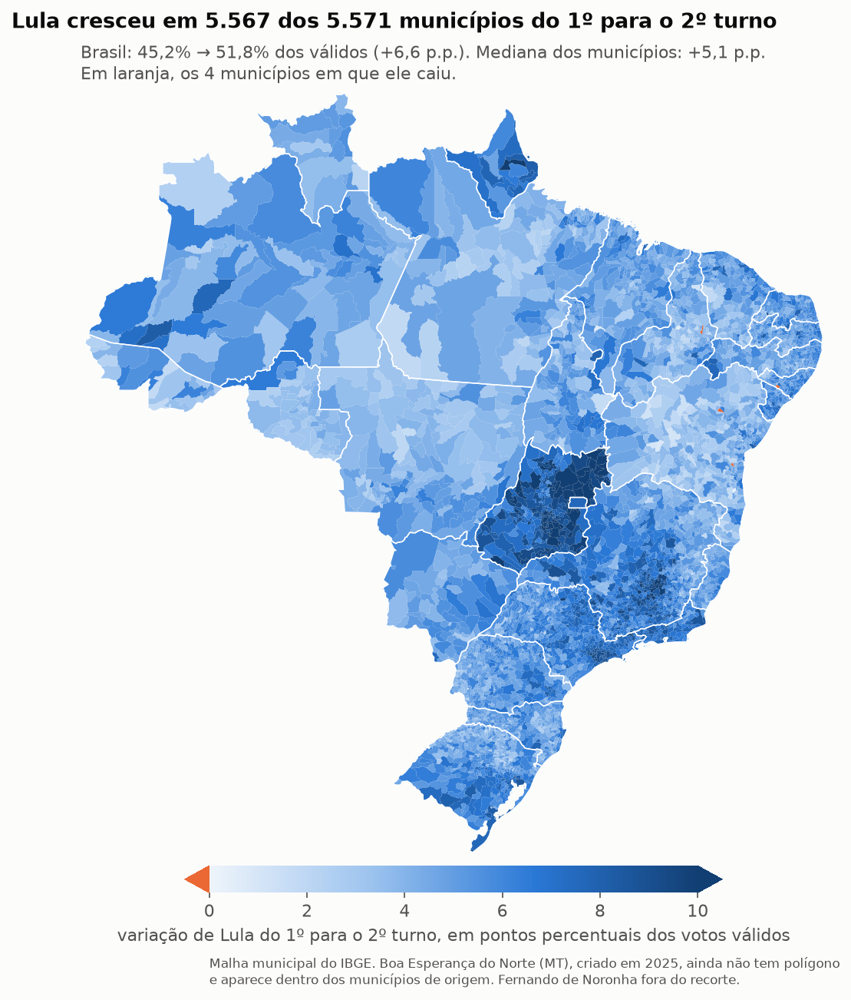

# Auditoria independente da eleição presidencial de 2026

Conferência, com os dados públicos do TSE, do resultado da eleição para Presidente de 2026 (1º turno em
04/10, 2º turno em 25/10, Lula × Flávio Bolsonaro). Duas perguntas guiam o trabalho: os números oficiais batem com o que
as urnas registraram? E existe nos dados algum sinal de que o resultado foi alterado?

Dá para refazer tudo. Os dados estão no repositório (ou se baixam com um comando) e cada número sai de um script
que pode ser lido e rodado. Se você achar um erro, abra uma issue com o script e o resultado.

O relatório formal, com escopo, metodologia, achados e parecer, está em
[`docs/RELATORIO_DE_AUDITORIA.md`](docs/RELATORIO_DE_AUDITORIA.md).

---

## Sumário

1. [Resultado](#1-resultado)
2. [Suspeitas que circularam](#2-suspeitas-que-circularam)
3. [Glossário](#3-glossário)
4. [De onde veio cada dado](#4-de-onde-veio-cada-dado)
5. [Problemas nos dados](#5-problemas-nos-dados)
6. [As verificações, uma por uma](#6-as-verificações-uma-por-uma)
7. [Quanto cada suspeita pesa na margem](#7-quanto-cada-suspeita-pesa-na-margem)
8. [O que esta auditoria não prova](#8-o-que-esta-auditoria-não-prova)
9. [Como rodar tudo](#9-como-rodar-tudo)
10. [Mapa do repositório](#10-mapa-do-repositório)

---

## 1. Resultado

Não encontrei nos dados públicos do TSE nenhum sinal de que o resultado do 2º turno tenha sido fabricado ou
alterado. Lula venceu por 4.430.191 votos, e nenhuma das suspeitas testadas chega perto de explicar essa
diferença.

| Pergunta | Resposta | Onde ver |
|---|---|---|
| O resultado oficial é a soma dos boletins de urna? | Sim, exatamente, em todas as UFs e nos dois turnos. | [6.2](#62-a-soma-dos-boletins-bate-com-o-resultado-oficial) |
| Os boletins batem com o que a urna gravou? | Sim. Recontei voto a voto o registro digital (RDV) de todas as 499.178 seções com urna eletrônica, e todas batem com a planilha (Lula, Flávio, brancos e nulos). O relatório oficial também conta 499.178 seções apuradas em urna eletrônica. | [6.4](#64-recontagem-voto-a-voto-e-logs-das-urnas) |
| As urnas usadas eram as previstas antes da eleição? | Em 99,4% das seções, exatamente as previstas. As trocas têm registro. Sobram 17 seções (4.563 votos) sem explicação nos dados. | [6.5](#65-as-urnas-usadas-eram-as-previstas) |
| Houve "duas eleições", antes e depois das 17h? | Não. O padrão vem do fuso horário e da geografia. Aparece igual em 2022 e já existia no 1º turno nas mesmas seções. | [6.6](#66-houve-duas-eleições-antes-e-depois-das-17h) |
| As urnas que ficaram abertas até as 19h receberam votos a mais? | Não. O fechamento às 19h aconteceu (6.352 seções), mas pelos logs só 4.492 votos (0,24%) foram dados depois das 17h nessas urnas, e elas votaram como as vizinhas que fecharam às 17h. | [6.7](#67-as-seções-que-fecharam-às-19h) |
| Os 8,6 milhões liberados sem digital decidiram a eleição? | Não há sinal disso. A taxa de liberação é uma característica estável de cada seção, e comparando seções da mesma cidade ela não mostra efeito a favor de Lula. Onde ela é maior, Lula foi um pouco pior do que o 1º turno indicava. | [6.8](#68-eleitores-liberados-sem-digital) |
| O 2º turno destoa do 1º? | Não. O 1º turno explica 92% das diferenças entre seções da mesma cidade no 2º turno, e nenhum grupo de seções suspeito sai do padrão. | [6.11](#611-1º-turno--2º-turno-seção-por-seção) |

Continua em aberto:
- Por que cerca de 1.100 locais de votação ficaram abertos até as 19h no 2º turno. Os dados mostram que
  aconteceu, mas não a decisão por trás. Isso se esclarece com os atos dos TREs.
- As 17 seções cuja urna não tem explicação nos dados. Isso se esclarece com as atas dessas seções.
- As assinaturas digitais dos arquivos das urnas não foram verificadas criptograficamente. É a principal
  limitação técnica deste trabalho (ver [seção 8](#8-o-que-esta-auditoria-não-prova)).
- Nenhum boletim de papel (por exemplo, fotografado por fiscais de partido) foi comparado com os arquivos. Tudo
  aqui compara arquivos publicados pelo próprio TSE entre si.


### Resultado oficial (igual à soma dos boletins de urna)

| 1º turno, 04/10/2026 | Votos | % dos válidos |
|---|---|---|
| Flávio Bolsonaro (22) | 56.104.503 | 47,03% |
| Lula (13) | 53.879.538 | 45,16% |
| Augusto Cury (70) | 3.448.569 | 2,89% |
| Renan Santos (14) | 2.675.887 | 2,24% |
| Ronaldo Caiado (55) | 2.605.148 | 2,18% |
| Demais 7 candidatos | 587.143 | 0,49% |
| Válidos | 119.300.788 | |
| Brancos / nulos | 2.300.798 / 3.674.249 (inclui 5.246 nulos técnicos) | |
| Comparecimento | 125.275.835 (78,92% dos aptos) | |

| 2º turno, 25/10/2026 | Votos | % dos válidos |
|---|---|---|
| Lula (13) | 64.256.232 | 51,79% |
| Flávio Bolsonaro (22) | 59.826.041 | 48,21% |
| Margem | 4.430.191 | |
| Brancos / nulos | 1.430.496 / 2.723.305 | |
| Comparecimento | 128.236.074 (80,78% dos aptos) | |

Do 1º para o 2º turno, Lula foi de 45,2% para 51,8% e Flávio de 47,0% para 48,2%. A virada foi parecida em
todas as regiões, e o 1º turno de cada seção prevê bem o 2º ([6.11](#611-1º-turno--2º-turno-seção-por-seção)).
Comparecimento por UF e comparação estado a estado: [`PRIMEIRO_TURNO.md`](analise/PRIMEIRO_TURNO.md), seção 9.



Lula cresceu em 5.567 dos 5.571 municípios. O ganho foi maior onde os candidatos que ficaram fora do 2º turno
tinham mais votos: em Goiás, onde Ronaldo Caiado teve 12,3% dos válidos no 1º turno, a mediana dos municípios foi
de +8,9 p.p.; no Acre e em Rondônia, de +3,4 e +3,5 p.p. No país, dos 7,8 pontos que os outros candidatos somavam,
6,6 viraram crescimento de Lula e 1,2 de Flávio. É um saldo por município, não o caminho de cada eleitor: mudanças
de comparecimento, brancos e nulos também entram na conta. Os 4 municípios em que Lula caiu (Belo Monte/AL,
Santo Antônio de Lisboa/PI, Caldeirão Grande/BA e Nova Ibiá/BA) são pequenos. Gráfico gerado por
`analise/graficos.py` (g11) com a malha municipal do IBGE (`dados/ibge/`).

---

## 2. Suspeitas que circularam

Depois do 2º turno circularam afirmações de fraude baseadas nos próprios dados do TSE. Testei as que podem ser
conferidas com números:

| # | Afirmação | O que os dados mostram |
|---|---|---|
| 1 | Nas urnas fechadas até 17h Flávio venceu (52,39%), e a virada só veio depois das 17h. | Confere, mas o grupo "até 17h" junta regiões onde Flávio foi bem por causa do fuso ([6.6](#66-houve-duas-eleições-antes-e-depois-das-17h)) |
| 2 | "Mais de 2 milhões de eleitores" votaram em seções fechadas depois das 19h. | Eram 2,3 milhões de aptos; votaram 1,86 milhão, e só 4.492 depois das 17h ([6.7](#67-as-seções-que-fecharam-às-19h)) |
| 3 | 8.632.488 eleitores liberados sem biometria, quase o dobro da margem. | Confere, mas os liberados não votaram em bloco num candidato ([6.8](#68-eleitores-liberados-sem-digital)) |
| 4 | 106 seções com 100% para Lula contra 4 para Flávio. | Confere; é voto regional, como em 2022 ([6.9](#69-seções-quase-unânimes)) |
| 5 | A Lei de Benford indicaria manipulação. | Os testes de dígitos não encontram sinal, mas detectam pouca coisa ([6.10](#610-lei-de-benford)) |
| 6 | Os dados ficaram "trancados" por 72 horas. | Em parte: os arquivos estavam no servidor cerca de 1 dia depois, mas o catálogo só os listou em 27/10 ([6.12](#612-dados-trancados-por-72-horas)) |

Afirmações políticas e jurídicas não estão nos dados de votação e ficaram de fora.

### Onde essas leituras erram

Quase todos os números dessas afirmações se reproduzem. O problema está na interpretação. O mais comum é ler o
relógio da urna como se fosse o de Brasília: a urna grava a hora do lugar onde está (ver
[problema 1](#5-problemas-nos-dados)), então urnas do Acre, do Amazonas e do Centro-Oeste que fecharam às 17h de
Brasília aparecem como 15h ou 16h e caem no grupo "fechou antes das 17h". Como são regiões em que Flávio foi
bem, o grupo parece outra eleição. O mesmo corte aplicado a 2022 dá o mesmo desenho, e as mesmas seções já
votavam assim no 1º turno de 2026.

Outro erro frequente é olhar o país inteiro de uma vez. Diferenças entre regiões passam por efeito do horário ou
da biometria, e somem quando se comparam só seções da mesma cidade. Também aparecem grandezas que não se
comparam (8,6 milhões de liberados contra 4,4 milhões de margem só faria sentido se todos tivessem votado no
mesmo candidato), eleitores aptos contados como votantes (nas seções das 19h eram 2,30 milhões de aptos e 1,86
milhão de votantes, pelo relógio local) e Benford no primeiro dígito, que não serve para votos por seção.

Uma pergunta legítima sobra: por que cerca de 1.100 locais de votação ficaram abertos até as 19h no 2º turno.
A resposta está nos atos dos TREs. Os dados mostram que isso não alterou o resultado.

---

## 3. Glossário

| Termo | O que significa |
|---|---|
| Seção | Uma "mesa" de votação: uma sala, uma urna, algumas centenas de eleitores. O Brasil tem cerca de 499 mil. |
| Local de votação | O prédio (geralmente uma escola) onde ficam várias seções. |
| BU (Boletim de Urna) | O resultado que a urna imprime e grava no fim da votação, com o total de cada candidato. |
| BWeb | A planilha do TSE com o conteúdo de todos os BUs. |
| RDV (Registro Digital do Voto) | Arquivo da urna com cada voto digitado, embaralhado (sem dizer quem votou). Permite recontar. |
| Log da urna | Diário automático da urna, com a hora de cada evento (eleitor liberado, voto computado, erro…). |
| Aptos / comparecimento | Quem podia votar / quem votou. |
| % Lula | Neste trabalho, salvo aviso: votos de Lula ÷ (Lula + Flávio). |
| Margem | Votos de Lula − votos de Flávio: 4.430.191. |
| Saldo | Votos de Lula − votos de Flávio dentro de um grupo de seções. |
| Liberação manual | Quando a digital do eleitor falha 4 vezes e o mesário libera por outro caminho. É o número chamado de "sem biometria" (8,6 milhões). Não confundir com quem não tem biometria cadastrada (outra linha do BU). |
| Urna de contingência | Urna reserva, preparada antes, que substitui uma urna com defeito. |
| Correspondência esperada | Lista publicada pelo TSE na véspera dizendo qual urna (e qual "carga" de software) vai em cada seção. |
| Hash SHA-512 | Uma espécie de impressão digital do arquivo: se um byte muda, o hash muda. Prova que o arquivo é o mesmo que foi publicado. |
| Horário local × Brasília | A urna grava a hora no fuso do lugar. No Acre, 17h de Brasília aparece como 15h. |
| p.p. (pontos percentuais) | Diferença entre porcentagens: de 50% para 52% são 2 p.p. |
| Resíduo | Diferença entre o resultado real de uma seção e o que se esperava dela a partir do 1º turno. |
| Comparar "dentro do município" | Comparar só seções da mesma cidade, para que diferenças entre regiões não atrapalhem. |
| Margem de erro de 95% / EP | Faixa onde o valor verdadeiro provavelmente está. EP = erro-padrão; ±1,96 EP dá a margem de 95%. |

---

## 4. De onde veio cada dado

Os dados da eleição vêm do Portal de Dados Abertos do TSE (<https://dadosabertos.tse.jus.br>) e do servidor de
arquivos do TSE (`cdn.tse.jus.br`); a malha do mapa vem do IBGE. Tudo baixado em 29/10/2026.

| # | Dado | Conteúdo | Origem | No repositório | Tamanho | Conferência |
|---|---|---|---|---|---|---|
| A | BUs do 2º turno 2026 (BWeb, todos os cargos) | Todas as seções: votos, horários, liberações | [Resultados 2026 – Boletim de Urna](https://dadosabertos.tse.jus.br/dataset/resultados-2026-boletim-de-urna) | `dados/tse/2026/boletim_urna/2turno/` | 138 MB | `.sha512` oficial, 28/28 |
| B | BUs do 1º turno 2026 (todos os cargos) | Idem, 1º turno | mesmo link | só os `.sha512` (os .zip têm 4,8 GB) | — | `.sha512` oficial, 28/28 |
| C | Só as linhas de Presidente, 1º e 2º turno 2026 e 2º turno 2022 | Copiadas byte a byte de A, B e E | `scripts/extrair_presidente.py` | `dados/tse/2026/presidente/`, `dados/tse/2022/presidente/` | 406 MB | `MANIFESTO.csv` liga cada arquivo ao .zip oficial e ao hash do TSE |
| D | Correspondências esperadas, 2º turno | Urna e carga previstas por seção e urnas de contingência, geradas em 24/10/2026 às 12:31 | [Correspondências esperadas](https://dadosabertos.tse.jus.br/dataset/resultados-2026-correspondencias-esperadas-e-efetivadas-2-turno) | `dados/tse/2026/correspondencias/2turno/` | 36 MB | `.sha512` oficial, 28/28 |
| E | BUs do 2º turno 2022 | Comparação com a eleição anterior | [Resultados 2022 – Boletim de Urna](https://dadosabertos.tse.jus.br/dataset/resultados-2022-boletim-de-urna) | `dados/tse/2022/boletim_urna/2turno/` | 67 MB | `.sha512` oficial, 28/28 |
| F | Arquivos originais das urnas de AC, RR e AP | Por urna: BU digital, imagem do BU impresso, RDV, log, assinatura | [Arquivos transmitidos para totalização](https://dadosabertos.tse.jus.br/dataset/resultados-2026-arquivos-transmitidos-para-totalizacao) | `dados/tse/2026/arquivos_urna/2turno/partes/` (pedaços de 90 MB) | 1,2 GB | sem hash oficial; `MANIFESTO.csv` próprio |
| G | RDV e logs das demais UFs | Lidos direto do servidor, baixando só o trecho necessário | mesmo link de F | resultados em `dados/derivados/` | — | conferidos contra a BWeb |
| H | Resultado oficial (Relatório Resultado da Totalização) | PDF assinado, Brasil e cada UF, 1º e 2º turnos | `cdn.tse.jus.br/.../Relatorio_Resultado_Totalizacao_2026_BR.zip` | `dados/tse/2026/totalizacao/` | 0,5 MB | sem hash oficial |
| I | Tabelas prontas | Uma linha por seção, logs das seções tardias, recontagem RDV, locais de votação | geradas pelos scripts | `dados/derivados/` | ~40 MB | regeneráveis |
| J | Malha municipal e estadual do IBGE | Polígonos dos municípios e estados e lista de municípios, só para o mapa (gráfico 11) | [API de malhas do IBGE](https://servicodados.ibge.gov.br/api/docs/malhas?versao=3) | `dados/ibge/` | 0,9 MB | `MANIFESTO.csv` próprio (URL, data, SHA-512) |

Também guardei o que o servidor informa sobre a data dos arquivos (`SERVIDOR.csv`) e quando o catálogo do
portal os listou (`CATALOGO.csv`), em `dados/tse/2026/boletim_urna/2turno/`.

---

## 5. Problemas nos dados

| # | Problema | Como resolvi |
|---|---|---|
| 1 | O horário de fechamento está no relógio local da urna. No Acre e no oeste do Amazonas, 17h de Brasília aparece como 15h; em MT, MS, RO, RR e no resto do AM, como 16h; em Fernando de Noronha, como 18h. | Converti por município. Há três provas em [`FUSO.md`](analise/FUSO.md): (1) as urnas abrem às 06h no AC, 07h no Norte/Centro-Oeste e 08h no resto, ou seja, todas às 8h de Brasília; (2) nenhum boletim chegou ao TSE (relógio do servidor, em Brasília) antes das 17h05, e o menor intervalo entre "fechou" e "chegou" é de cerca de 2h no AC, 1h no Norte/Centro-Oeste e 0h no resto; (3) o log de cada urna mostra o operador digitando a hora à mão na preparação (as urnas não têm internet). O exterior ficou fora da conversão. Ignorar isso é a principal fonte de leituras erradas dos dados. |
| 2 | O BU do 2º turno de Roraima não aparecia no catálogo, só o `.sha512`. | Baixei pela URL direta. Hash conferido. |
| 3 | Os BUs do 2º turno sumiram do catálogo entre a 1ª e a 2ª consulta (29/10). Os arquivos continuam no servidor, iguais. | Registrado em `CATALOGO.csv`. Não sei o motivo. |
| 4 | Os arquivos originais das urnas do 2º turno não estão no catálogo e não têm hash oficial. | Baixei pela URL padrão e registrei tamanho, SHA-512, data e ETag em `MANIFESTO.csv`. |
| 5 | O GitHub não aceita arquivos acima de 100 MB. | Pacotes das urnas em partes de 90 MB (`scripts/remontar_arquivos_urna.sh` junta e confere). Do 1º turno, versionei só as linhas de Presidente. |
| 6 | Em 2022 o campo de biometria tem outro nome e o código do cargo vem entre aspas. | O leitor aceita os dois formatos. |
| 7 | O código de carga vem partido em duas colunas no BU, e a lista prévia perde zeros à esquerda. | Juntei e completei para 24 dígitos. |
| 8 | O leia-me diz que o log é 7z, mas é zip. Urnas substituídas trazem o log anterior dentro de outro zip. | O leitor abre os dois níveis. |
| 9 | O resultado oficial só existe em PDF. | Extraído com `pdftotext`. |
| 10 | Seções do exterior sem eleitores presentes não têm linhas de Presidente na BWeb (2 no 2º turno, 1 no 1º); no 2º turno aparecem só com cargo "-1". | Explica 499.205 seções com voto contra 499.207 em funcionamento no oficial. |
| 11 | 29 seções do exterior não têm horário porque foram apuradas em cédula (Sistema de Apuração): 27 com votos e as 2 sem votantes do problema 10. | O relatório oficial confirma: "29 seções apuradas pelo SA". |
| 12 | No 1º turno, o nº 28 teve 5.246 votos que não aparecem no resultado oficial. | São exatamente os 5.246 "votos nulos técnicos" do oficial (registro anulado). |

---

## 6. As verificações, uma por uma

Cada verificação traz a pergunta, como foi calculada e o resultado. Os detalhes completos estão nos arquivos
`analise/*.md` indicados.

### 6.1 Os arquivos são os originais do TSE?

Calculei o SHA-512 de cada arquivo baixado e comparei com o `.sha512` publicado pelo TSE: 112 de 112 conferem.
O hash vem do mesmo servidor, então isso prova que o download está íntegro, não que o servidor é confiável. As
comparações seguintes (soma × PDF oficial, RDV × BU, log × BU) mostram que os arquivos do TSE são coerentes
entre si e que nada mudou entre a urna e a totalização, mas também usam arquivos do TSE. Uma conferência de
fora, com boletins de papel fotografados por fiscais, não foi feita.

### 6.2 A soma dos boletins bate com o resultado oficial?

`analise/totalizacao.py` soma, de todos os BUs, seções, aptos, comparecimento, brancos, nulos e votos de cada
candidato, por UF e no Brasil, e compara com o PDF oficial do TSE.

Votos, brancos, nulos e comparecimento batem exatamente em 29 de 29 regiões (27 UFs, exterior e Brasil), nos
dois turnos. Contando também seções e aptos, batem 27 de 29: as diferenças são 1 ou 2 seções do exterior sem
nenhum votante (problema 10), que pesam no exterior e no total do Brasil. O resultado
oficial do 2º turno (Lula 64.256.232, Flávio 59.826.041) foi assinado às 23h28 de 25/10. Detalhe:
[`analise/TOTALIZACAO.md`](analise/TOTALIZACAO.md).

### 6.3 Cada boletim faz sentido sozinho?

`analise/consistencia.py` aplica estas regras a cada um dos 499.205 BUs (538.946 pares seção × cargo):

| Regra | Violações |
|---|---|
| aptos = comparecimento + abstenções | 0 |
| comparecimento ≤ aptos | 0 |
| soma de todos os votos = comparecimento | 0 |
| liberados ≤ comparecimento | 0 |
| abertura < encerramento ≤ impressão do BU | 0 (fora as 29 seções de cédula, sem horário) |
| urna abriu no dia da eleição | 0 |
| comparecimento de Presidente menor que o de Governador | 0 (é sempre maior ou igual: quem vota em trânsito só vota para Presidente) |
| BU recebido pelo TSE antes de impresso pela urna | 8 seções, no máximo 52 segundos (relógio da urna levemente adiantado) |
| urna preparada no dia da eleição | 5 (urnas substituídas antes da abertura, que abriram atrasadas) |

Detalhe: [`analise/CONSISTENCIA.md`](analise/CONSISTENCIA.md).

### 6.4 Recontagem voto a voto e logs das urnas

A pergunta aqui é se a planilha do TSE é fiel ao que cada urna registrou.

O RDV guarda cada voto digitado. Escrevi um leitor do formato da urna (ASN.1/DER), contei os votos de
Presidente um a um e comparei com a planilha (`analise/recontagem_rdv.py` e `recontagem_rdv_nacional.py`).
Para AC, RR e AP também conferi o BU digital (`bu.dat`) e o código de carga gravado nele.

| Recontagem pelo RDV | Resultado |
|---|---|
| Seções com urna eletrônica recontadas (Brasil e exterior) | 499.178 |
| RDV idêntico à planilha (Lula, Flávio, brancos e nulos) | 499.178 de 499.178 |
| Lula / Flávio somando os RDVs | 64.255.787 / 59.825.688 |
| Diferença para o oficial | 445 / 353, exatamente os votos das 27 seções do exterior apuradas em cédula, cujo arquivo não segue o formato do RDV da urna |
| AC, RR e AP: BU digital (`bu.dat`) e código de carga = planilha | 5.703 de 5.703 |

Cada RDV foi lido direto do pacote oficial do TSE, baixando só aquele arquivo.

Logs e imagem do BU de AC, RR e AP (`analise/logs_urna.py`, `analise/imagem_bu.py`; 5.703 urnas). A imagem do BU
(`imgbu.dat`) é o texto que a urna manda imprimir e vem no mesmo pacote; não é o papel afixado na seção.

| Verificação | AC | RR | AP |
|---|---|---|---|
| Imagem do BU = planilha (votos, brancos, nulos, aptos, totais) | 2270/2270 | 1519/1519 | 1914/1914 |
| Votos no log = comparecimento | 2270/2270 | 1519/1519 | 1914/1914 |
| Liberações (digital, manual, sem biometria cadastrada) no log = BU | 2270/2270 | 1519/1519 | 1914/1914 |
| Voto registrado depois do fechamento | 0 | 0 | 0 |

Pelos logs dá para ver como funciona a liberação manual: a digital do eleitor falha 4 vezes, a urna pede um
dado pessoal e, se ele não confere, recusa. Depois a urna pede a digital do mesário. Nos três estados houve
1.383 recusas, e 338 eleitores saíram sem votar depois disso. Das liberações manuais, 71% têm o mesário
identificado pelo nome; em 13% a digital dele foi lida mas não pode ser associada a um nome; em 16% foi
capturada e não encontrada entre os mesários. Digitar só o ano de nascimento é outro caminho, o de quem não tem
biometria cadastrada (outra linha do BU).


Detalhes: [`RECONTAGEM_RDV.md`](analise/RECONTAGEM_RDV.md), [`RECONTAGEM_RDV_NACIONAL.md`](analise/RECONTAGEM_RDV_NACIONAL.md),
[`LOGS.md`](analise/LOGS.md), [`IMAGEM_BU.md`](analise/IMAGEM_BU.md).

### 6.5 As urnas usadas eram as previstas?

`analise/correspondencia.py` compara, seção por seção, a urna e o código de carga do BU com a lista de
correspondências do TSE, que tem data de geração de 24/10 às 12:31 (baixada em 29/10; datas de carga convertidas
para Brasília). Cada seção cai numa categoria:

| Categoria | Seções | Votos | Saldo de Lula |
|---|---|---|---|
| 1. urna e carga exatamente as previstas | 496.138 | 127.447.547 | +4.401.710 |
| 2. urna prevista, carga diferente da lista | 9 | 2.467 | −55 |
| 3. urna de contingência da lista, com a carga da lista | 2.641 | 686.899 | +21.744 |
| 4. urna de contingência da lista, recarregada | 258 | 63.989 | +1.902 |
| 5. urna fora das listas, carregada depois que a lista foi gerada | 45 | 12.032 | +1.968 |
| 6. urna fora das listas, mesmo cartão de carga da urna prevista | 59 | 15.027 | +2.230 |
| 7. urna fora das listas, sem explicação nos dados | 16 | 4.275 | −19 |
| 8. seção fora da lista: exterior, apurada em cédula | 27 | 831 | +92 |
| 9. seção fora da lista, urna de contingência da lista | 11 | 2.719 | +558 |
| 10. seção fora da lista, urna fora das listas | 1 | 288 | +61 |

As categorias 2, 4, 5, 6 e 9 têm explicação provável nos próprios dados, mas precisam de confirmação nas atas.
As categorias 7 e 10 somam 17 seções e 4.563 votos sem explicação, com saldo de +42 para Lula. Lista:
[`secoes_para_documentar.csv`](analise/secoes_para_documentar.csv). Detalhe:
[`analise/CORRESPONDENCIA.md`](analise/CORRESPONDENCIA.md).

### 6.6 Houve "duas eleições", antes e depois das 17h?

`analise/suspeitas.py` separa as seções pelo horário de fechamento como gravado pela urna (relógio
local), nas faixas usadas na afirmação, e soma os votos.

Os números da afirmação saem exatos: até 17:00:59, 150.771 seções e Flávio com 52,39%; de 17:01 a 17:15,
339.593 seções, 88.071.750 eleitores e 53,46% para Lula. Mas o corte não indica duas eleições:

1. O mesmo corte dá "duas eleições" em 2022 (Bolsonaro +1,0 milhão "até 17h", e Lula vira depois):


2. A diferença vem da geografia. Os estados a oeste (onde o relógio marca 15h ou 16h quando são 17h em Brasília)
   são 21% das seções do grupo e 83% da vantagem de Flávio nele. Comparando só seções do mesmo estado, a
   diferença cai de −5,9 para −1,4 p.p.; do mesmo município, para −0,2 p.p. E as mesmas seções já votavam assim
   no 1º turno (−5,95 p.p.):


3. Fechar entre 17:01 e 17:15 é o normal: quem está na fila às 17h vota, e a urna fecha depois do último
   eleitor. Essa faixa tem 68% das seções do país (73% em horário de Brasília).

### 6.7 As seções que fecharam às 19h

Isto aconteceu de fato: no 2º turno, 6.352 seções (em horário de Brasília) fecharam às 19h ou pouco depois,
1.993 delas no minuto 19:00 exato e 6.319 entre 19:00 e 19:15. O formato é o de um horário-limite marcado, não o
de uma fila. Elas se concentram em 1.131 locais de votação, 313 deles inteiros, sobretudo nas capitais (Rio
1.978, São Paulo 1.481, Salvador 730). Não aparece no 1º turno, que teve fechamentos tardios espalhados, por
fila, nem em 2022.


O que os dados mostram sobre os votos dessas seções:

- Quase ninguém votou no horário extra. Lendo o log de cada uma das 6.352 urnas direto do servidor do TSE, só
  4.492 de 1.861.259 votos (0,24%) foram computados depois das 17h, e 3.885 urnas não tiveram nenhum voto depois
  das 17h15. O total de votos no log bate com o BU em 100% das urnas.


- Votaram como as vizinhas. Comparando com seções do mesmo local de votação que fecharam às 17h, a diferença é
  de −0,06 p.p. na % de Lula e +0,03 p.p. no comparecimento. O comparecimento delas foi de 80,6% (país: 80,8%).
  Nos 313 locais em que todas as seções fecharam às 19h não há vizinha para comparar; esses entram na comparação
  com o 1º turno, logo abaixo.
- Votaram como no próprio 1º turno. Lula subiu 3,25 p.p. nelas e 3,20 p.p. nas demais seções das mesmas
  cidades. O limite superior de 95% na forma mais desfavorável do modelo é de 24.498 votos (0,6% da margem).
- Mesmo anulando todas essas seções, Lula venceria por 4.244.467 votos. No RJ, que tem mais seções tardias,
  Flávio venceu nelas (45,8% para Lula).
- A afirmação de "mais de 2 milhões de eleitores" só bate contando os aptos. Pelo relógio local, como na
  afirmação, são 6.333 seções com 2,30 milhões de aptos e 1,86 milhão de votantes.

Por que esses locais ficaram abertos até as 19h os dados não dizem. Detalhe:
[`LOGS_TARDIAS.md`](analise/LOGS_TARDIAS.md), [`RESULTADOS.md`](analise/RESULTADOS.md) seção 4.

### 6.8 Eleitores liberados sem digital

O número confere: 8.632.488 (6,73% do comparecimento). Compará-lo com a margem só faria sentido se esses
eleitores tivessem votado em bloco num candidato. Testei isso de quatro formas.

**1. Pior caso aritmético.** Se em cada seção todo liberado tivesse votado em Lula e fosse retirado, Flávio
venceria por 4,19 milhões. Mas esse cenário exige um comportamento que os testes seguintes descartam.

**2. Inclinação**, ou seja, quanto a % de Lula muda quando a taxa de liberação muda. Daí sai uma estimativa de
como votaram os liberados:

| Comparando… | % de Lula entre os liberados (estimativa) | Margem sem os liberados (limite de 95%) |
|---|---|---|
| o país todo | 79% | −2,80 mi |
| dentro do estado | 68% | −0,22 mi |
| dentro do município | 54% | +2,55 mi |

O exterior fica fora desta conta (lá não há biometria, a liberação é zero por definição); os votos dele
entram na margem. Liberação e voto em Lula são, os dois, maiores em certas regiões (Nordeste, interior). Comparar o país todo
atribui à liberação um efeito que é da geografia (a chamada falácia ecológica). A comparação justa é entre seções
da mesma cidade, e aí os liberados votam quase como os demais.

**3. Contra o 1º turno**, que é o teste mais forte. Dado como a própria seção votou no 1º turno, mais liberação
vem com menos Lula do que o esperado (−0,37 p.p. a cada 10 p.p. de liberação), e o aumento da liberação entre
os turnos não tem efeito (+0,01 p.p., margem de erro ±0,03). Se a liberação tivesse sido usada para pôr votos em
Lula, o sinal seria o contrário.

**4. Estabilidade.** A taxa de cada seção se repete entre os turnos (correlação 0,82) e é parecida no Nordeste
(7,2%) e no resto do país (6,6%). É uma característica da seção (idade do eleitorado, digitais gastas, leitor
biométrico) e já era assim no 1º turno.

Os cenários 1 e 2 (país e estado) virariam a eleição, mas só se os liberados tivessem votado em bloco ou se a
geografia não explicasse a relação. Os testes 3 e 4 descartam as duas coisas. Por isso o número usado na
seção 7 é o da comparação dentro do município, com os outros mostrados ao lado.

#### Por estado, por hora e por mesário

Detalhe completo em [`BIOMETRIA.md`](analise/BIOMETRIA.md) (script `analise/biometria.py`).

Por estado, considerando todas as seções, a taxa vai de 4,1% (RR) a 9,0% (PI) e quase não mudou entre os turnos
(Brasil sem o exterior: 6,68% → 6,75%; maior variação estadual: 0,57 p.p.). Ela é alta tanto onde Lula venceu (PI 9,0%, RN
8,1%, BA 7,5%) quanto onde Flávio venceu com folga (RS 8,45%, SC 7,5%, RJ 7,5%).


Também li, eleitor a eleitor e com a hora de cada voto, o log de 10.809 urnas: as 6.352 seções que fecharam às
19h, 1.500 vizinhas do mesmo local que fecharam até 17h15 e uma amostra aleatória de 3.000 seções do Brasil (43
delas caíram também nos outros grupos). Em 100% delas o número de liberações manuais no log é igual ao do
boletim. As vizinhas são um sorteio diferente do usado em 6.7, e como foram escolhidas entre seções que fecharam
até 17h15, só servem de comparação para a janela das 17h às 17h15 e para a taxa do dia.

| Grupo | Votos | % manual no dia | Votos depois das 17h | Liberações manuais depois das 17h |
|---|---|---|---|---|
| Amostra aleatória do Brasil | 771.027 | 6,84% | 193 | 20 |
| Seções que fecharam às 19h | 1.861.259 | 6,35% | 4.492 | 245 (5,45% desses votos) |
| Vizinhas que fecharam até 17h15 | 435.553 | 6,66% | 172 | 17 |

- Nas seções abertas até as 19h, só 245 eleitores foram liberados manualmente depois das 17h, em 220 das 6.352
  seções. Em 164 dessas liberações o mesário foi identificado pela digital. Mesmo que todos fossem ilegítimos e de Lula, seriam
  0,006% da margem.
- Nos logs lidos, a taxa de liberação manual é maior de manhã e cai ao longo do dia em todos os grupos, sem
  aumento significativo no horário estendido (depois das 17h há poucos votos, então a taxa por hora oscila mais).
  Se as liberações tivessem sido usadas para encher urnas no fim do dia, o padrão seria o oposto.


Casos extremos: em 16 das 10.809 seções lidas, um único mesário liberou 50 ou mais eleitores (o máximo foi 165,
numa seção do Rio de Janeiro). Em 2 delas o log mostra quase todos liberados manualmente de manhã e a digital
voltando a funcionar à tarde, o que indica leitor biométrico com defeito, depois consertado ou trocado. Em 11 das
16, Lula teve menos votos na seção do que na zona eleitoral dela. São casos que vale conferir nas atas, mas não
mostram favorecimento a um candidato.

### 6.9 Seções quase unânimes

| Eleição | 100% Lula | 100% adversário | >90% Lula | >90% adversário |
|---|---|---|---|---|
| 2º turno 2026 | 106 | 4 | 6.816 | 378 |
| 1º turno 2026 | 81 | 8 | 6.005 | 713 |
| 2º turno 2022 | 143 | 4 | 9.433 | 213 |

As contagens que circularam (106 contra 4) estão certas, mas 75% das seções com mais de 90% para Lula estão em
MA, BA, PI, PE e CE, onde ele teve entre 69% e 76%. Numa região em que a média é 70%, é normal haver muitas seções
acima de 90%.

### 6.10 Lei de Benford

| Teste | Resultado |
|---|---|
| 1º dígito | Lula e Flávio "falham" do mesmo jeito (dígito 1 em ~61%). É o esperado: o voto de um candidato numa seção fica entre 100 e 199 em 61% dos casos. O teste não serve para votos por seção (Deckert, Myagkov & Ordeshook, 2011). |
| 2º dígito | Média real de 3,86 (Lula) e 3,97 (Flávio). Numa eleição honesta simulada para Lula com o mesmo tamanho de seção, 3,87. Não há diferença. |
| Último dígito (Beber & Scacco) | Uniforme para os dois (qui-quadrado 5,0 e 12,4; limite 16,9). |

Os testes de dígitos não encontram sinal de números inventados, mas detectam pouca coisa: servem como
complemento, não como prova.

### 6.11 1º turno × 2º turno, seção por seção

A mesma seção, com os mesmos eleitores, votou duas vezes em três semanas. Se urnas tivessem sido manipuladas no
2º turno, essas seções sairiam do padrão que o 1º turno indicava.

`analise/primeiro_turno.py` prevê, para cada seção, a % de Lula no 2º turno a partir dos votos de cada candidato,
brancos, nulos e abstenção no 1º turno. Usei seis formas do modelo (linear e logit; nacional, por estado, por
município; com e sem peso pelo tamanho da seção) e comparei o desvio médio de grupos de seções, com margem de
erro agrupada por município.


O 1º turno explica 97,9% das diferenças entre seções no país e 91,6% comparando só seções da mesma cidade. O
erro típico fica entre 2,2 e 2,5 p.p.


Nenhum grupo suspeito se desvia de forma relevante. Nas seções das 19h o resultado depende da forma do modelo:
em 2 das 6 formas (linear nacional, com e sem peso) o desvio é positivo e significativo isoladamente (+0,35 p.p.,
EP 0,12), e dentro do município vira −0,20 (EP 0,17). Como são 18 comparações (3 grupos × 6 formas), nenhuma
resiste à correção para testes múltiplos (Bonferroni), e o sinal muda quando se compara dentro do estado ou do
município, o que aponta para geografia. O limite superior de 95% na forma mais desfavorável é de 24.498 votos.
Esse limite usa erro-padrão agrupado por município, e 75% das seções das 19h estão em só 5 municípios, o que
pode subestimar a incerteza; mesmo dobrado, ficaria em cerca de 49 mil votos (1,1% da margem). As seções de muita
liberação manual ficam abaixo do previsto para Lula em todas as formas.

Há 747 seções muito fora do padrão (mais de 4 desvios), divididas entre os dois lados; somando só os desvios a
favor de Lula, dá 11.896 votos, e o efeito líquido é de 3.487. O corte em 4 desvios é arbitrário: com 2 desvios
são 23.039 seções, 274.058 votos a favor de Lula e efeito líquido de 17.868
([`PRIMEIRO_TURNO.md`](analise/PRIMEIRO_TURNO.md), seção 7).

Este teste tem limites, e por isso não é o único: não detecta uma manipulação igual em todas as seções (essa é
coberta pela soma oficial e pelo RDV), nem uma manipulação que também tenha ocorrido no 1º turno, nem a de um
município inteiro na comparação dentro do município (a nacional pega). Detalhe:
[`PRIMEIRO_TURNO.md`](analise/PRIMEIRO_TURNO.md).

### 6.12 "Dados trancados por 72 horas"

| Evento | Quando |
|---|---|
| Resultado oficial assinado (totalização) | 25/10, 23h28 |
| Planilha BWeb gerada | 26/10, 07h42 |
| BWeb no servidor (`Last-Modified`) | 26/10, por volta das 09h00 de Brasília; o arquivo do exterior, às 16h49 (`SERVIDOR.csv`) |
| Arquivos originais das urnas no servidor | 26/10, entre 15h26 e 17h01 de Brasília (`MANIFESTO.csv`) |
| BWeb listada no catálogo do portal | 27/10, por volta das 19h no relógio do catálogo, sem fuso informado (`CATALOGO.csv`) |

Os arquivos estavam no servidor cerca de 1 dia depois da eleição, mas só apareceram no catálogo, que é onde as
pessoas procuram, cerca de 2 dias depois, e em 29/10 já tinham saído dele de novo. A crítica de que os dados
demoraram a ficar acessíveis tem fundamento. A de que estavam escondidos para serem alterados, não: os arquivos batem com o resultado
assinado às 23h28 do próprio dia 25, e o BU de cada urna é impresso e afixado na seção na noite da eleição (esses
papéis não foram comparados aqui; as datas vêm do servidor e dos metadados do TSE).

---

## 7. Quanto cada suspeita pesa na margem

Valores calculados em `analise/graficos.py` (gráfico 8), exceto a liberação manual, que vem da seção 6.8.

| Suspeita | Pior caso | % da margem |
|---|---|---|
| Anular todas as seções que fecharam às 19h | 185.724 votos | 4,2% |
| Seções das 19h: limite de 95% do desvio em relação ao 1º turno, forma mais desfavorável | 24.498 | 0,6% |
| Seções das 19h: todos os votos dados depois das 17h | 4.492 | 0,1% |
| Seções muito fora do padrão 1º → 2º turno (só desvios a favor de Lula, corte em 4 desvios) | 11.896 | 0,3% |
| Seções com urna sem explicação nos dados (todos os votos) | 4.563 | 0,1% |
| Liberação manual, limite de 95% comparando dentro do município | a margem cairia para 2,55 mi | 42% |

A liberação manual é a única suspeita com cenários que invertem o resultado: −4,19 mi no pior caso aritmético,
−2,80 mi no limite de 95% comparando o país todo e −0,22 mi comparando dentro do estado. Esses cenários supõem
que os liberados votaram em bloco ou que a geografia não explica a relação, e os testes contra o 1º turno (6.8,
itens 3 e 4) descartam as duas hipóteses.

---

## 8. O que esta auditoria não prova

- As assinaturas digitais das urnas (`*.vsc`) não foram verificadas criptograficamente. Elas provariam que os
  arquivos foram gerados por urnas oficiais. É o próximo passo técnico.
- Logs e imagem do BU foram lidos para AC, RR e AP; logs também para todas as seções das 19h, dois sorteios de
  seções vizinhas e uma amostra aleatória de 3.000 seções do Brasil (11.382 urnas distintas no total).
  Não para todas as urnas.
- Nenhuma análise de dados prova que o software da urna é honesto. Isso cabe aos testes públicos de segurança e
  à fiscalização. O que os dados mostram é que BU, RDV, logs e resultado oficial contam a mesma história.
- Nenhum boletim de papel foi comparado com os arquivos. Todas as conferências usam arquivos publicados pelo TSE;
  a comparação com boletins fotografados por fiscais de partido seria a conferência de fora.
- As leituras remotas (RDV de todo o país e logs fora de AC, RR e AP) foram feitas por download parcial, sem hash
  do pacote inteiro; foram conferidas contra a BWeb.
- Por que houve fechamento às 19h e o que explica as 17 urnas sem registro só os atos dos TREs e as atas dizem.
- Afirmações políticas e jurídicas não estão nos dados do TSE.
- Os testes estatísticos estimam efeitos com margem de erro. Os de contagem (soma oficial, RDV, logs) são exatos.

---

## 9. Como rodar tudo

Precisa de Python 3 e `pdftotext` (pacote `poppler-utils`).

```bash
git clone https://github.com/JardaCoder/elections-brazil.git
cd elections-brazil
pip install pandas numpy tabulate matplotlib geopandas   # geopandas só para o mapa (gráfico 11)

scripts/remontar_arquivos_urna.sh       # junta os pacotes das urnas de AC, RR e AP

cd analise
python3 totalizacao.py                  # 6.2  soma dos BUs × resultado oficial
python3 fuso.py                         # 5    prova de que a urna grava o horário local
python3 consistencia.py                 # 6.3  regras em cada BU
python3 recontagem_rdv.py AC RR AP      # 6.4  recontagem voto a voto (local)
python3 imagem_bu.py AC RR AP           # 6.4  imagem do BU × planilha
python3 logs_urna.py AC RR AP           # 6.4  log da urna × BU
python3 correspondencia.py              # 6.5  urnas usadas × previstas
python3 suspeitas.py                    # 6.6–6.10 horário, seções das 19h, liberação, unânimes, Benford
python3 primeiro_turno.py               # 6.11 1º × 2º turno
python3 biometria.py                    # 6.8  liberação manual (usa cache; --refazer lê logs do servidor, ~30 min)
python3 graficos.py                     # gráficos em docs/graficos/

# Leem direto do servidor do TSE (demoram):
python3 logs_tardias.py --refazer       # 6.7  logs das 6.352 seções das 19h (~20 min)
python3 recontagem_rdv_nacional.py      # 6.4  RDV de todas as seções do país (~2 h)
```

Para baixar outros dados: `python3 scripts/baixar_dados_tse.py` lista os conjuntos.
Para refazer a extração de Presidente a partir dos .zip oficiais: `python3 scripts/extrair_presidente.py`.

---

## 10. Mapa do repositório

```
README.md                          este arquivo
docs/RELATORIO_DE_AUDITORIA.md     relatório formal: escopo, metodologia, achados, limitações e parecer
analise/
  RESULTADOS.md                    horário, seções das 19h, liberação, unânimes, Benford (6.6 a 6.10)
  PRIMEIRO_TURNO.md                1º × 2º turno (6.11)
  TOTALIZACAO.md                   soma dos BUs × oficial (6.2)
  FUSO.md                          prova de que a urna grava o horário local (problema 1)
  CONSISTENCIA.md                  regras por BU (6.3)
  RECONTAGEM_RDV.md                recontagem voto a voto AC/RR/AP (6.4)
  RECONTAGEM_RDV_NACIONAL.md       recontagem voto a voto, Brasil (6.4)
  IMAGEM_BU.md, LOGS.md            imagem do BU e logs × planilha (6.4)
  BIOMETRIA.md                     liberação manual: por estado, município, hora e mesário (6.8)
  CORRESPONDENCIA.md               urnas usadas × previstas (6.5)
  LOGS_TARDIAS.md                  votos depois das 17h nas seções das 19h (6.7)
  secoes_para_documentar.csv       seções com urna/carga fora da lista
  secoes_fora_do_padrao_1t_2t.csv  seções muito fora do padrão entre turnos
  carregar.py                      lê os dados; fuso por município; faixas de horário
  estatistica.py                   modelos, comparações e margem de erro
  *.py                             um script por verificação (ver seção 9)
scripts/
  baixar_dados_tse.py              baixa dados do TSE e confere o hash
  extrair_presidente.py            separa as linhas de Presidente dos .zip oficiais
  remontar_arquivos_urna.sh        junta as partes dos pacotes das urnas
docs/graficos/                     gráficos deste README
dados/
  tse/2026/boletim_urna/2turno/    BWeb 2º turno (todos os cargos) + SERVIDOR.csv + CATALOGO.csv
  tse/2026/boletim_urna/1turno/    só os .sha512 (os .zip: baixar)
  tse/2026/presidente/             linhas de Presidente, 1º e 2º turno, + MANIFESTO.csv
  tse/2026/correspondencias/       urnas previstas por seção
  tse/2026/arquivos_urna/2turno/   arquivos originais das urnas AC/RR/AP (partes + MANIFESTO.csv)
  tse/2026/totalizacao/            resultado oficial (PDF)
  tse/2022/                        2º turno 2022 (comparação)
  derivados/                       tabelas prontas geradas pelos scripts
  ibge/                            malha municipal e estadual e lista de municípios do IBGE (mapa, gráfico 11)
```

---

Trabalho independente, sem vínculo com o TSE, partidos ou candidatos.
