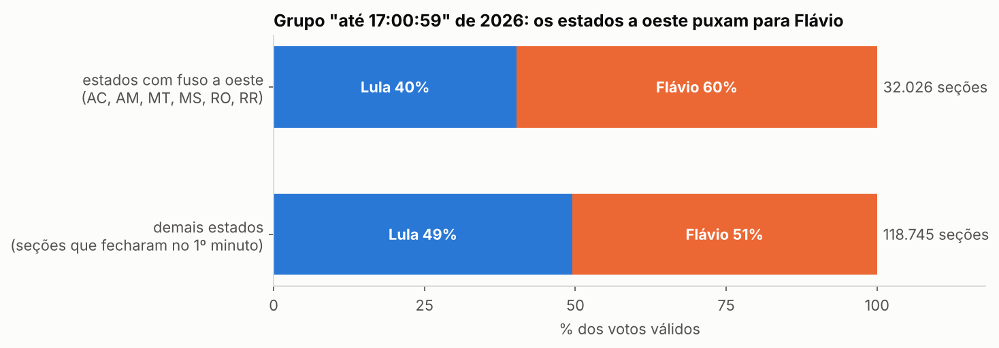
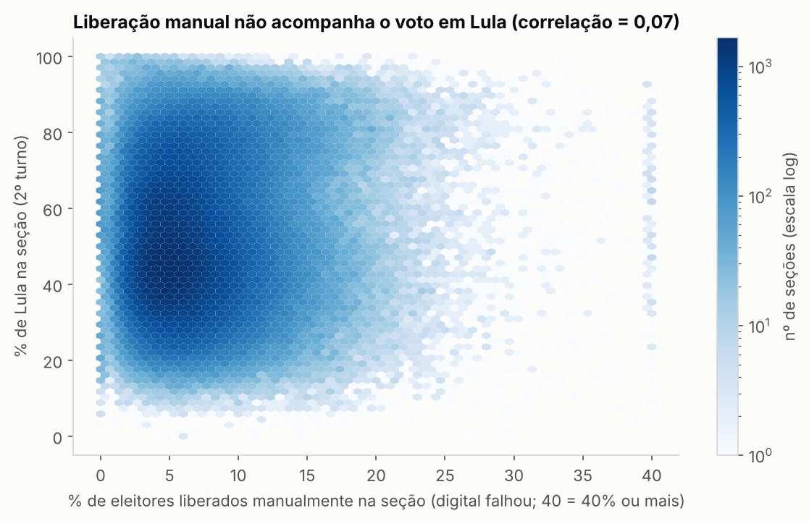
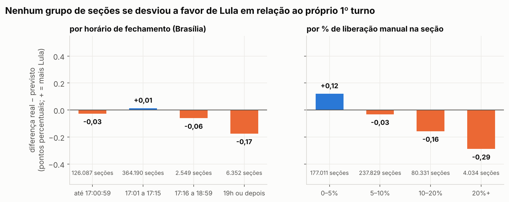

# Auditoria independente da eleição presidencial de 2026

Este repositório confere, com os dados públicos do TSE, um "Relatório Pericial Independente" que
circulou nas redes depois do 2º turno de 2026. Também faz uma auditoria própria dos dados da eleição.

Tudo aqui pode ser refeito por qualquer pessoa: os dados estão no repositório (ou podem ser baixados
com um comando), e cada número vem de um script que você pode ler e rodar.

---

## Sumário

1. [Resumo em 30 segundos](#1-resumo-em-30-segundos)
2. [Contexto: o que o relatório diz](#2-contexto-o-que-o-relatório-diz)
3. [Glossário: as palavras que aparecem aqui](#3-glossário-as-palavras-que-aparecem-aqui)
4. [De onde veio cada dado](#4-de-onde-veio-cada-dado)
5. [Problemas que encontrei nos dados (e como resolvi)](#5-problemas-que-encontrei-nos-dados-e-como-resolvi)
6. [As verificações, uma por uma](#6-as-verificações-uma-por-uma)
   - [6.1 Os arquivos são os originais do TSE?](#61-os-arquivos-são-os-originais-do-tse)
   - [6.2 A soma dos boletins bate com o resultado oficial?](#62-a-soma-dos-boletins-bate-com-o-resultado-oficial)
   - [6.3 Cada boletim de urna faz sentido sozinho?](#63-cada-boletim-de-urna-faz-sentido-sozinho)
   - [6.4 O que a urna gravou bate com o boletim?](#64-o-que-a-urna-gravou-bate-com-o-boletim)
   - [6.5 As urnas usadas eram as previstas antes da eleição?](#65-as-urnas-usadas-eram-as-previstas-antes-da-eleição)
   - [6.6 Réplica do relatório: "duas eleições" antes e depois das 17h](#66-réplica-do-relatório-duas-eleições-antes-e-depois-das-17h)
   - [6.7 As seções que fecharam às 19h](#67-as-seções-que-fecharam-às-19h)
   - [6.8 Eleitores liberados sem biometria](#68-eleitores-liberados-sem-biometria)
   - [6.9 Seções quase unânimes](#69-seções-quase-unânimes)
   - [6.10 Lei de Benford](#610-lei-de-benford)
   - [6.11 1º turno × 2º turno, seção por seção](#611-1º-turno--2º-turno-seção-por-seção)
   - [6.12 "Dados escondidos por 72 horas"](#612-dados-escondidos-por-72-horas)
7. [Juntando tudo: quanto cada suspeita pesa na margem](#7-juntando-tudo-quanto-cada-suspeita-pesa-na-margem)
8. [O que esta auditoria NÃO prova](#8-o-que-esta-auditoria-não-prova)
9. [Como rodar tudo você mesmo](#9-como-rodar-tudo-você-mesmo)
10. [Mapa do repositório](#10-mapa-do-repositório)

---

## 1. Resumo em 30 segundos

- **Os números do relatório estão certos.** Consegui reproduzir cada tabela dele, número por número.
- **As conclusões do relatório estão erradas.** Ele mistura fuso horário com fraude, e o mesmo
  "padrão suspeito" aparece na eleição de 2022.
- **A soma dos 499.205 boletins de urna bate 100% com o resultado oficial do TSE**, em todas as UFs e
  nos dois turnos.
- **Os registros internos de 5.703 urnas (AC, RR e AP) batem 100% com os boletins impressos.**
- **O 1º turno prevê o 2º turno seção por seção com 97,9% de precisão.** Nenhum grupo de seções
  (fechadas tarde, com muita liberação manual) se desviou a favor de Lula.
- **Sobraram 168 seções que pedem documentação** (urna diferente da lista prévia). Somam 4.835 votos de
  saldo, 0,1% da margem.
- **Uma coisa real:** no 2º turno, 6.352 seções fecharam perto das 19h, um pico que não existe no 1º turno
  nem em 2022. Os dados mostram que isso aconteceu, mas não por quê. O peso delas é de cerca de 187 mil
  votos de saldo, 4% da margem, e elas votaram como já tinham votado no 1º turno.


---

## 2. Contexto: o que o relatório diz

O "Relatório Pericial Independente — Eleições 2026" (8 páginas, compartilhado no Instagram) afirma:

| # | Afirmação |
|---|---|
| 1 | As urnas que fecharam **até 17h** deram vitória a Flávio Bolsonaro (52,39%). A virada de Lula viria **só das urnas fechadas depois das 17h**, por uma "prorrogação". |
| 2 | Mais de 2 milhões de eleitores votaram em seções que fecharam **depois das 19h**, com votação "avassaladora" para Lula. |
| 3 | **8.632.488** eleitores foram liberados **sem biometria**, quase o dobro da margem de Lula (4.430.191). |
| 4 | Há **106 seções com 100% para Lula** contra **4 para Flávio**, uma "anomalia". |
| 5 | Teste da **Lei de Benford** (sem mostrar o resultado). |
| 6 | Os microdados ficaram **"trancados" por 72 horas**. |
| 7 | Afirmações políticas e jurídicas (decisões de ministros, passaportes, PF, reações internacionais). |

Os itens 1 a 6 podem ser testados com os dados do TSE, e foi o que fiz. O item 7 não está nos dados (ver [seção 8](#8-o-que-esta-auditoria-não-prova)).

---

## 3. Glossário: as palavras que aparecem aqui

| Termo | O que significa |
|---|---|
| **Seção** | Uma "mesa" de votação: uma sala, uma urna, algumas centenas de eleitores. O Brasil tem cerca de 499 mil. |
| **BU (Boletim de Urna)** | O papel que a urna imprime ao final da votação com o total de votos de cada candidato. Ele é afixado na porta da seção e também enviado ao TSE. |
| **BWeb** | A planilha que o TSE publica com o conteúdo de **todos** os BUs, uma linha por candidato por seção. |
| **Aptos** | Eleitores que podiam votar naquela seção. |
| **Comparecimento** | Quantos votaram de fato. |
| **Votos válidos** | Votos em candidatos (sem contar brancos e nulos). As porcentagens oficiais são sobre os válidos. |
| **Margem** | Votos de Lula menos votos de Flávio no 2º turno: **4.430.191**. |
| **Liberação manual / "habilitação biográfica"** | Quando a digital do eleitor falha 4 vezes, o mesário libera a votação por outro caminho. É o número que o relatório chama de "sem biometria". |
| **Log da urna** | Um diário que a urna grava sozinha, com horário de cada evento: eleitor liberado, voto computado, erro, etc. |
| **Urna de contingência** | Urna reserva, preparada antes, que substitui uma urna que quebrou. |
| **Correspondência esperada** | Lista que o TSE publica **antes** da eleição dizendo qual urna (número de série e código de carga) vai em cada seção. |
| **Hash SHA-512** | Uma "impressão digital" de um arquivo. Se um único byte mudar, o hash muda completamente. Serve para provar que o arquivo é o mesmo que o TSE publicou. |
| **Correlação** | Número de −1 a 1 que diz se duas coisas sobem juntas. Perto de 0 quer dizer que uma não tem relação com a outra. |
| **p.p. (pontos percentuais)** | Diferença entre porcentagens. De 50% para 52% são 2 p.p. |

---

## 4. De onde veio cada dado

Todos os dados vêm do **Portal de Dados Abertos do TSE** (<https://dadosabertos.tse.jus.br>) ou do
servidor de arquivos do TSE (`cdn.tse.jus.br`). Baixei tudo em 29/10/2026.

| # | Dado | O que tem dentro | Link de origem | No repositório | Tamanho | Como conferi |
|---|---|---|---|---|---|---|
| A | **Boletins de urna do 2º turno 2026** (BWeb) | Todas as 499.205 seções, todos os votos, horário de abertura e fechamento, liberações manuais | [Resultados 2026 – Boletim de Urna](https://dadosabertos.tse.jus.br/dataset/resultados-2026-boletim-de-urna) | `dados/tse/2026/boletim_urna/2turno/` | 138 MB | `.sha512` oficial: 28/28 ✅ |
| B | **Boletins de urna do 1º turno 2026** | O mesmo, para o 1º turno (todos os cargos) | Mesmo link | **Só os hashes** em `dados/tse/2026/boletim_urna/1turno/`; a tabela já processada está em `dados/derivados/` | 4,8 GB | `.sha512` oficial: 28/28 ✅ |
| C | **Boletins de urna do 2º turno 2022** | Grupo de controle (Lula × Jair Bolsonaro) | [Resultados 2022 – Boletim de Urna](https://dadosabertos.tse.jus.br/dataset/resultados-2022-boletim-de-urna) | `dados/tse/2022/boletim_urna/2turno/` | 67 MB | `.sha512` oficial: 28/28 ✅ |
| D | **Correspondências esperadas do 2º turno** | Urna e código de carga previstos para cada seção, gerados em 24/10/2026 (véspera) | [Correspondências esperadas e efetivadas – 2º turno](https://dadosabertos.tse.jus.br/dataset/resultados-2026-correspondencias-esperadas-e-efetivadas-2-turno) | `dados/tse/2026/correspondencias/2turno/` | 36 MB | `.sha512` oficial: 28/28 ✅ |
| E | **Arquivos originais das urnas** de AC, RR e AP | Para cada urna: BU, imagem do BU impresso, log, RDV (registro digital do voto) e assinatura digital | [Arquivos transmitidos para totalização](https://dadosabertos.tse.jus.br/dataset/resultados-2026-arquivos-transmitidos-para-totalizacao) | `dados/tse/2026/arquivos_urna/2turno/partes/` (em pedaços de 90 MB) | 1,2 GB | O TSE **não** publica hash; registrei o meu em `MANIFESTO.csv` ⚠️ |
| F | **Relatório Resultado da Totalização** | O resultado oficial assinado, Brasil e cada UF, 1º e 2º turnos (PDF) | `cdn.tse.jus.br/.../Relatorio_Resultado_Totalizacao_2026_BR.zip` | `dados/tse/2026/totalizacao/` | 0,5 MB | Sem hash oficial ⚠️ |
| G | **Tabelas por seção** (geradas por mim) | Uma linha por seção com votos de Presidente; 1º e 2º turno de 2026 e 2º turno de 2022 | Gerada por `analise/carregar.py` a partir de A, B e C | `dados/derivados/` | 30 MB | Regenerável |

**Dados que existem no TSE mas não usei:** votação por município, perfil do eleitorado, mesários,
prestação de contas, logs do sistema de preparação das urnas (Gedai) e os arquivos originais das urnas das
outras 24 UFs (mais de 100 GB). O script `scripts/baixar_dados_tse.py` baixa qualquer um deles.

---

## 5. Problemas que encontrei nos dados (e como resolvi)

Nenhum problema abaixo afeta o resultado. Eles estão aqui porque quem for refazer a análise vai topar com eles.

| # | Problema | Onde | Como resolvi |
|---|---|---|---|
| 1 | O BU do 2º turno de **Roraima** não aparece no catálogo do portal; só o `.sha512` dele aparece | Dado A | Baixei pela URL direta, que segue o padrão das outras UFs. O hash bateu. |
| 2 | O download de **SP do 1º turno** (1,4 GB) caiu no meio ("connection reset") | Dado B | Baixei de novo. O hash bateu. |
| 3 | Os **arquivos originais das urnas do 2º turno** não aparecem no catálogo (só os do 1º) e **não têm hash oficial** | Dado E | Baixei pela URL direta e registrei tamanho, SHA-512, data e ETag do servidor no `MANIFESTO.csv`. |
| 4 | O GitHub não aceita arquivos acima de 100 MB | Dado E | Dividi os pacotes em partes de 90 MB. O script `scripts/remontar_arquivos_urna.sh` junta as partes e confere o hash. |
| 5 | **O horário de fechamento está no relógio local da urna**, não no de Brasília. No Acre, 17h de Brasília aparece como 15h. | Dado A | Converti para Brasília somando 1h (AM, MT, MS, RO, RR) ou 2h (AC). **Esta é a origem do principal erro do relatório** (ver 6.6). |
| 6 | Em 2022 o campo de biometria tem outro nome (`QT_ELEITORES_BIOMETRIA_NH`) e as datas vêm em outro formato | Dado C | O leitor aceita os dois formatos. |
| 7 | O código de carga da urna vem **partido em duas colunas** no BU, e a lista esperada **perde zeros à esquerda** | Dados A e D | Juntei as duas colunas e completei com zeros até 24 dígitos. |
| 8 | O "leia-me" diz que o log vem em formato 7z, mas na verdade é **zip**. Urnas substituídas trazem o log da urna anterior **dentro** de outro zip. | Dado E | O leitor abre os dois níveis. |
| 9 | O resultado oficial só existe em **PDF**; a API de resultados (`resultados.tse.jus.br`) respondeu 404 nos endereços que testei | Dado F | Extraí o texto do PDF com `pdftotext` e li os números com expressões regulares. |
| 10 | 2 seções do exterior (Ciudad Guayana e Trípoli) aparecem no BU sem linha de Presidente | Dado A | Ninguém votou nelas (comparecimento zero). Por isso a planilha tem 499.205 seções com voto e o TSE conta 499.207 em funcionamento. |
| 11 | 29 seções do exterior não têm horário de abertura nem de fechamento e compartilham dois números de "urna" | Dado A | São as seções apuradas pelo **Sistema de Apuração** (cédula de papel). O relatório oficial confirma: "29 seções apuradas pelo SA". |
| 12 | No 1º turno, o candidato nº 28 teve 5.246 votos nas urnas que não aparecem no resultado oficial | Dados B e F | O relatório oficial lista exatamente **5.246 "votos nulos técnicos"**: o registro do candidato foi anulado e os votos dele viraram nulos. |

**Erros que eu mesmo cometi e corrigi** (para transparência):
- No começo achei que o número "sem biometria" do relatório correspondia a outra linha do BU. Conferindo com
  o BU impresso e com o log, vi que corresponde à **"habilitação biográfica"**, exatamente como o relatório
  diz. Corrigi o texto.
- A primeira versão do leitor de logs não abria o log de urnas substituídas e contava eleitores que
  desistiram de votar. Depois de corrigir, a conferência passou de ~98% para 100%.
- Na primeira versão do modelo 1º→2º turno, os pesos não podiam ser interpretados (colinearidade).
  Corrigi tirando o intercepto. A previsão (R²) não mudou.

---

## 6. As verificações, uma por uma

Cada verificação traz **a pergunta**, **como foi calculado**, **o resultado** e **onde está o detalhe**.

### 6.1 Os arquivos são os originais do TSE?

**Como calculei:** para cada arquivo que o TSE publica com um `.sha512` ao lado, calculei o SHA-512 do
arquivo baixado (`sha512sum arquivo.zip`) e comparei com o publicado.

**Resultado:** 112 de 112 arquivos conferem (BU 2026 dos dois turnos, BU 2022 e correspondências).

---

### 6.2 A soma dos boletins bate com o resultado oficial?

**A pergunta:** se eu somar à mão todos os boletins de urna, chego ao mesmo resultado que o TSE anunciou?

**Como calculei** (`analise/totalizacao.py`):
1. Somei, de todos os BUs, os votos de cada candidato, brancos, nulos e comparecimento, por UF e no Brasil.
2. Li os mesmos números do **Relatório Resultado da Totalização** oficial (PDF).
3. Subtraí um do outro, região por região.

**Resultado:**

| | Regiões comparadas | Batem exatamente |
|---|---|---|
| 1º turno | 27 UFs + exterior + Brasil | **29 de 29** |
| 2º turno | 27 UFs + exterior + Brasil | **29 de 29** |

Resultado oficial do 2º turno: Lula **64.256.232**, Flávio **59.826.041**. A soma dos BUs dá **exatamente** isso.
O relatório oficial foi gerado às **23h28 do próprio dia 25/10**.

Detalhe: [`analise/TOTALIZACAO.md`](analise/TOTALIZACAO.md)

---

### 6.3 Cada boletim de urna faz sentido sozinho?

**A pergunta:** algum BU tem conta que não fecha, como mais votos que eleitores?

**Como calculei** (`analise/consistencia.py`): para cada um dos 499.205 BUs, testei estas regras:

| Regra | Violações |
|---|---|
| aptos = comparecimento + abstenções | **0** |
| comparecimento ≤ aptos | **0** |
| soma de todos os votos = comparecimento | **0** |
| liberados sem biometria ≤ comparecimento | **0** |
| uma única urna por seção | **0** |
| BU recebido pelo TSE depois de impresso | **0** |
| urna abriu no dia da eleição | 29 exceções (as seções com cédula, ver problema 11) |
| urna foi preparada (carga) antes do dia da eleição | 5 exceções (urnas substituídas antes da abertura) |

Também conferi que, onde houve 2º turno para governador, o comparecimento para Presidente é **sempre
maior ou igual**, nunca menor. A diferença é o voto em trânsito: quem vota fora do seu estado só vota para Presidente.

Detalhe: [`analise/CONSISTENCIA.md`](analise/CONSISTENCIA.md)

---

### 6.4 O que a urna gravou bate com o boletim?

**A pergunta:** a planilha do TSE é fiel ao que cada urna registrou?

**O que usei:** para AC, RR e AP (5.703 urnas), os arquivos originais de cada urna:
- `imgbu.dat`: a "imagem" do BU impresso, em texto;
- `logd.dat`: o diário da urna, com cada evento e o horário.

**Como calculei** (`analise/imagem_bu.py` e `analise/logs_urna.py`):
1. Do BU impresso, li votos por candidato, comparecimento e os três tipos de liberação de eleitor.
2. No log, percorri **eleitor por eleitor**: identificação → tentativas de digital → tipo de liberação → voto computado.
3. Contei e comparei com o BU e com a planilha.

**Resultado:**

| Verificação | AC | RR | AP |
|---|---|---|---|
| BU impresso = planilha do TSE (votos de cada candidato) | 2270/2270 | 1519/1519 | 1914/1914 |
| Votos no log = comparecimento do BU | 2270/2270 | 1519/1519 | 1914/1914 |
| Liberações manuais no log = número do BU | 2270/2270 | 1519/1519 | 1914/1914 |
| Voto registrado depois do fechamento da urna | 0 | 0 | 0 |

**Como funciona a "liberação sem biometria", segundo o log:**
1. A urna pede a digital do eleitor e tenta **4 vezes**.
2. Se falhar, pede um **dado pessoal** do eleitor ao mesário. Se o dado não confere, **a urna recusa**: houve 1.383 recusas só nesses 3 estados.
3. Depois a urna exige a **digital do mesário** e grava **qual mesário** liberou.

Ou seja, não é a "simples digitação do ano de nascimento" que o relatório descreve.


A taxa de liberação manual é mais alta de manhã e cai ao longo do dia. **Não há pico no fim da votação**,
que é onde uma fraude desse tipo deixaria marca.

Detalhe: [`analise/LOGS.md`](analise/LOGS.md)

---

### 6.5 As urnas usadas eram as previstas antes da eleição?

**A pergunta:** alguma urna "apareceu do nada"?

**Como calculei** (`analise/correspondencia.py`): para cada seção, comparei a urna e o código de carga que
aparecem no BU com a lista que o TSE publicou em **24/10**, a véspera da eleição.

**Resultado:**

| | Seções |
|---|---|
| Usou exatamente a urna prevista | 496.147 (99,4%) |
| …e também o código de carga previsto | 496.138 |
| Urna trocada por **urna de contingência que já estava na lista** | 2.899 |
| **Pedem documentação** (urna fora da lista, carga diferente ou seção fora da lista) | **168** |

As 168 seções somam 37.639 votos, com saldo líquido de **4.835 votos para Lula (0,1% da margem)**. 97 delas
usaram urnas preparadas em 24/10, o mesmo dia em que a lista foi gerada, então são provavelmente trocas
feitas depois da lista. Para fechar essa ponta, o próximo passo é pedir as atas dessas seções aos TREs.
Lista completa: [`analise/secoes_para_documentar.csv`](analise/secoes_para_documentar.csv).

Detalhe: [`analise/CORRESPONDENCIA.md`](analise/CORRESPONDENCIA.md)

---

### 6.6 Réplica do relatório: "duas eleições" antes e depois das 17h

**O que o relatório diz:** nas urnas fechadas até 17h, Flávio venceu com 52,39%. A vitória de Lula viria
das urnas fechadas depois.

**Como replicei** (`analise/verificar_relatorio.py`): separei as seções pelo horário de fechamento **como
está gravado no arquivo** (relógio local) nas faixas: até 17:00:59, 17:01–17:15, 17:16–18:59, 19h ou depois.
Somei os votos de cada faixa.

**Resultado: os números do relatório saem exatos.** Na faixa 17:01–17:15 são 339.593 seções, 88.071.750
eleitores e 53,46% para Lula, como no relatório. Até 17:00:59, Flávio tem 52,39%.

**Por que a conclusão está errada:**

**1. O mesmo "padrão" aparece em 2022.** Apliquei exatamente o mesmo corte à eleição de 2022:


Em 2022 Bolsonaro também "venceu até as 17h" (por 1,0 milhão) e Lula também "virou depois". Se isso fosse
sinal de fraude em 2026, seria em 2022 também. Na verdade não é sinal de nada.

**2. O grupo "até 17h" é diferente por causa do fuso horário.** As urnas de AC, AM, MT, MS, RO e RR
fecham às 17h de Brasília, mas o relógio delas marca 15h ou 16h. Por isso **todas** caem no grupo
"até 17h". São estados onde Flávio é muito forte:



Além disso, fecham no primeiro minuto as seções **menores e sem fila**. As maiores, nas cidades grandes,
têm fila às 17h e fecham alguns minutos depois.

**3. A faixa 17:01–17:15 não é "prorrogação".** Pela regra, quem está na fila às 17h vota, e a urna fecha
depois do último eleitor. Essa faixa tem **68% de todas as seções do país**. É o fechamento normal.

---

### 6.7 As seções que fecharam às 19h

**O que o relatório diz:** mais de 2 milhões de eleitores votaram em seções que fecharam depois das 19h,
com votação "avassaladora" para Lula.

**Como calculei:** contei as seções pelo horário de fechamento (convertido para Brasília), minuto a minuto,
no 1º turno de 2026, no 2º turno de 2026 e no 2º turno de 2022.


**O que é real:** no 2º turno de 2026 há um **pico de fechamentos exatamente às 19h00** (6.352 seções), que
não existe no 1º turno nem em 2022. Isso é compatível com uma extensão de horário em locais específicos,
como o relatório menciona. Os dados não dizem quem decidiu nem por quê.

**O que não se sustenta:**
- Essas seções deram a Lula um saldo de **187 mil votos, 4% da margem**. Tirando **todas** as seções fechadas
  depois das 17h15, Lula ainda vence por **4,1 milhões**.
- No RJ, que tem mais seções tardias que qualquer outro estado, **Flávio** venceu nelas.
- Elas votaram **como já tinham votado no 1º turno** (ver 6.11): a diferença entre o resultado real e o
  previsto foi de −0,17 p.p., ou seja, levemente **menos** Lula do que o esperado.
- Das 6.352 seções tardias do 2º turno, só 102 também fecharam tarde no 1º. São outras seções, não "as
  mesmas urnas de sempre".

---

### 6.8 Eleitores liberados sem biometria

**O que o relatório diz:** 8.632.488 eleitores liberados sem biometria, quase o dobro da margem.

**O número confere.** Mas comparar com a margem só faria sentido se **todos** esses eleitores tivessem
votado no mesmo candidato. Testei isso de três formas:

**1. Correlação por seção** (`analise/verificar_relatorio.py`): para cada seção, calculei a % de
eleitores liberados manualmente e a % de Lula, e medi se uma acompanha a outra.



Correlação de **0,07** no país e **0,01** entre seções do mesmo município. Na prática, nenhuma relação.

**2. Retirada:** tirei todos os eleitores liberados manualmente, supondo que votaram como o resto da
própria seção. Lula ainda vence por **4,0 milhões**.

**3. Comparação com 2022:** o campo mais próximo em 2022 somou 10 milhões, **4,7 vezes** a margem daquele
ano. Se a razão entre liberações e margem fosse indício de fraude, 2022 estaria pior.

Também: a taxa de liberação manual de cada seção **se repete** entre o 1º e o 2º turno (correlação 0,82).
Ou seja, é uma característica da seção (por exemplo, eleitorado mais velho, digitais gastas ou um
leitor biométrico pior), não algo que surgiu no 2º turno.

---

### 6.9 Seções quase unânimes

**Como calculei:** contei as seções em que um candidato teve 100% (ou mais de 90%) dos votos válidos.

| | Lula | Flávio/Bolsonaro |
|---|---|---|
| 100% dos válidos, 2026 | 106 | 4 |
| 100% dos válidos, 2022 | 143 | 4 |
| Mais de 90%, 2026 | 6.816 | 378 |

**Confere com o relatório**, e em 2022 foi parecido. As seções com mais de 90% para Lula estão no
Maranhão, Bahia, Piauí, Pernambuco e Ceará, onde Lula teve cerca de 69%. Quando a média de uma região é
70%, é natural que existam muitas seções acima de 90%. O voto no Brasil é muito regional, e a distribuição
nacional não precisa ser "simétrica em torno de 50%".

---

### 6.10 Lei de Benford

**O que é:** em muitos conjuntos de números naturais, o primeiro dígito é "1" em cerca de 30% dos casos.
O teste vê se os números seguem essa curva.

**Como calculei:** peguei o primeiro dígito dos votos de cada candidato em cada seção e comparei com a curva.

| 1º dígito | Esperado (Benford) | Lula | Flávio |
|---|---|---|---|
| 1 | 30,1% | 60,8% | 61,9% |
| 2 | 17,6% | 9,3% | 7,2% |
| 3 | 12,5% | 0,9% | 2,8% |

**Os dois candidatos "falham" do mesmo jeito**, e isso é esperado. Uma seção tem no máximo uns 400
eleitores, então o voto de um candidato numa seção cai quase sempre entre 100 e 199, e o "1" domina. A
literatura (Deckert, Myagkov & Ordeshook, 2011) mostra que esse teste **não serve** para votos por seção.
O relatório disse que fez o teste, mas não mostrou o resultado.

---

### 6.11 1º turno × 2º turno, seção por seção

**A ideia:** é o teste mais forte. A **mesma seção**, com os **mesmos eleitores**, votou duas vezes com três
semanas de intervalo. Se alguém tivesse mexido nas urnas do 2º turno, essas seções fugiriam do padrão
que o 1º turno indicava.

**Como calculei** (`analise/primeiro_turno.py`):
1. Para cada seção, peguei a fatia de eleitores de cada candidato do 1º turno, mais brancos/nulos e abstenção.
2. Ajustei um modelo (regressão linear) que tenta **prever** a % de Lula no 2º turno a partir do 1º.
3. Para cada seção, calculei o **resíduo**: % real menos % prevista.
4. Comparei o resíduo médio entre grupos de seções: as que fecharam tarde, as com muita liberação manual etc.
   Fiz isso também "dentro do município", comparando só seções da mesma cidade.

**Resultado:**


O 1º turno explica **97,9%** da variação do 2º turno entre seções (R² = 0,979). O erro típico é de 2,5 p.p.



**Nenhum grupo suspeito se desviou a favor de Lula.** As seções que fecharam às 19h e as com muita
liberação manual tiveram resíduo **negativo**, ou seja, um pouco **menos** Lula do que o 1º turno previa.

Seções muito fora do padrão (mais de 4 desvios-padrão): 747 (0,15%), sendo 421 a favor de Lula e 326 a
favor de Flávio. Mesmo se **todas** fossem fraude, o efeito líquido seria de **3.487 votos**. Lista:
[`analise/secoes_fora_do_padrao_1t_2t.csv`](analise/secoes_fora_do_padrao_1t_2t.csv).

> **Nota:** no gráfico há um pequeno aglomerado abaixo da diagonal (Lula bem abaixo do previsto). São 269
> seções do **exterior** (Boston, Nagóia, Miami, Tóquio) com abstenção de 65%. O modelo supõe que parte de
> quem se absteve no 1º turno vota no 2º, e isso não vale fora do país. É uma limitação do modelo, não uma
> anomalia, e vai contra Lula, não a favor.

**Resultado do 1º turno** (soma dos BUs, igual ao oficial): Flávio 47,03%, Lula 45,16%, Augusto Cury
2,89%, Renan Santos 2,24%, Ronaldo Caiado 2,18%.

Detalhe: [`analise/PRIMEIRO_TURNO.md`](analise/PRIMEIRO_TURNO.md)

---

### 6.12 "Dados escondidos por 72 horas"

**O que o relatório diz:** os arquivos ficaram "trancados" até a manhã de quarta-feira, 28/10.

**Como verifiquei:** olhei a data que o próprio servidor do TSE informa para cada arquivo (cabeçalho
`Last-Modified`) e as datas dentro dos arquivos.

| Arquivo | Data |
|---|---|
| Resultado oficial assinado (totalização) | 25/10, 23h28 |
| Planilha BWeb gerada | 26/10, 07h42 |
| BWeb no servidor | 26/10, 09h00 (Brasília) |
| Arquivos originais das urnas no servidor | 26/10, entre 15h e 17h (Brasília) |

Ou seja, cerca de 1 dia depois, não 3. Além disso, cada seção afixa o BU impresso na porta ao final da votação.

---

## 7. Juntando tudo: quanto cada suspeita pesa na margem

| Suspeita | Pior caso: votos que poderia explicar | % da margem de 4.430.191 |
|---|---|---|
| Seções que fecharam às 19h ou depois (saldo de Lula nelas) | 186.954 | 4,2% |
| Seções com urna/carga fora da lista prévia | 4.835 | 0,1% |
| Seções fora do padrão 1º→2º turno | 3.487 | 0,1% |
| Eleitores liberados sem biometria | Sem relação com o voto (correlação 0,01); retirá-los mantém Lula +4,0 mi | — |

Mesmo somando os piores casos, não se chega perto da margem.

---

## 8. O que esta auditoria NÃO prova

Para ser honesto sobre os limites:

- **Assinatura digital das urnas:** não verifiquei criptograficamente as assinaturas (`*.vsc`). Isso
  provaria que os arquivos foram gerados pela urna oficial. É o próximo passo técnico.
- **Recontagem voto a voto (RDV):** o arquivo com cada voto individual (`*rdv.dat`) ainda não foi decodificado.
- **Só 3 estados nos logs:** os logs foram conferidos em AC, RR e AP. Os outros 24 estados somam mais de 100 GB;
  o script já funciona para eles.
- **O software da urna:** nenhuma análise de dados prova que o software da urna é honesto. Isso é feito
  pelos testes públicos de segurança e pela fiscalização de partidos, que não são cobertos aqui.
- **Fuso do oeste do Amazonas:** alguns municípios do AM ficam em UTC-5, e usei UTC-4 para o estado todo. Isso
  move poucas seções de faixa e não muda nenhuma conclusão.
- **Afirmações políticas e jurídicas do relatório** (decisões de ministros, passaportes, PF, Banco Master,
  reações internacionais): não estão nos dados do TSE e não foram avaliadas.
- **Por que houve fechamentos às 19h no 2º turno:** os dados mostram que aconteceu, mas não explicam a
  causa. Isso exige as decisões e as atas dos TREs.

---

## 9. Como rodar tudo você mesmo

Você precisa de Python 3 e de `pdftotext` (pacote `poppler-utils`).

```bash
git clone https://github.com/JardaCoder/elections-brazil.git
cd elections-brazil
pip install pandas tabulate matplotlib

# 1. Juntar os pacotes das urnas (AC, RR, AP) que estão em partes
scripts/remontar_arquivos_urna.sh

# 2. (Opcional) Baixar os BUs do 1º turno, 4,8 GB. Sem isso, os scripts usam a tabela já pronta em dados/derivados/
python3 scripts/baixar_dados_tse.py bu_1t

# 3. Rodar as análises. Cada uma gera um .md em analise/
cd analise
python3 totalizacao.py          # 6.2  soma dos BUs × resultado oficial
python3 consistencia.py         # 6.3  consistência de cada BU
python3 logs_urna.py AC RR AP   # 6.4  log da urna × BU
python3 correspondencia.py      # 6.5  urnas usadas × lista prévia
python3 verificar_relatorio.py  # 6.6–6.10  réplica do relatório
python3 primeiro_turno.py       # 6.11 1º × 2º turno
python3 graficos.py             # gráficos em docs/graficos/
```

Tempo total: uns 2 minutos, ou cerca de 7 se precisar reprocessar o 1º turno a partir dos BUs brutos.

Para baixar outros dados do TSE:

```bash
python3 scripts/baixar_dados_tse.py                          # lista os conjuntos disponíveis
python3 scripts/baixar_dados_tse.py arquivos_urna_2t SP MG   # arquivos originais das urnas de outros estados
```

---

## 10. Mapa do repositório

```
README.md                         este arquivo
analise/
  AUDITORIA.md                    resumo técnico da auditoria
  TOTALIZACAO.md                  6.2 — soma dos BUs × resultado oficial
  CONSISTENCIA.md                 6.3 — regras de consistência
  LOGS.md                         6.4 — logs das urnas
  CORRESPONDENCIA.md              6.5 — urnas usadas × previstas
  RESULTADOS.md                   6.6 a 6.10 — réplica do relatório
  PRIMEIRO_TURNO.md               6.11 — 1º × 2º turno
  secoes_para_documentar.csv      168 seções com urna fora da lista prévia
  secoes_fora_do_padrao_1t_2t.csv 747 seções fora do padrão entre turnos
  carregar.py                     lê os BUs e monta a tabela por seção
  totalizacao.py, consistencia.py, imagem_bu.py, logs_urna.py,
  correspondencia.py, verificar_relatorio.py, primeiro_turno.py, graficos.py
scripts/
  baixar_dados_tse.py             baixa dados do TSE e confere o hash
  remontar_arquivos_urna.sh       junta as partes dos pacotes das urnas
docs/graficos/                    gráficos deste README
dados/
  tse/2026/boletim_urna/2turno/   BUs 2º turno 2026 (+ .sha512)
  tse/2026/boletim_urna/1turno/   só os .sha512 do 1º turno (os .zip: baixar)
  tse/2026/correspondencias/      urnas previstas por seção (véspera)
  tse/2026/arquivos_urna/2turno/  arquivos originais das urnas AC/RR/AP (partes + MANIFESTO.csv)
  tse/2026/totalizacao/           resultado oficial (PDF)
  tse/2022/boletim_urna/2turno/   BUs 2º turno 2022 (controle)
  derivados/                      tabelas por seção já processadas
```

---

*Análise independente, sem vínculo com o TSE, com partidos ou com os autores do relatório. Achou um erro?
Abra uma issue com o script e o resultado, porque a ideia é justamente que qualquer pessoa possa conferir.*
