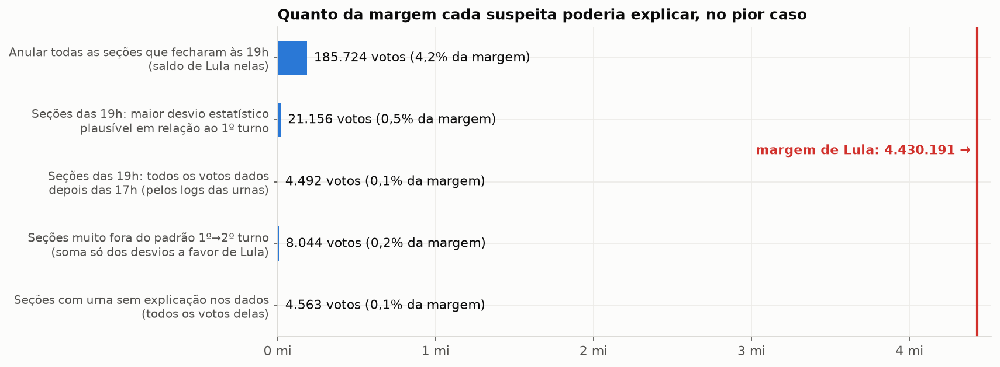
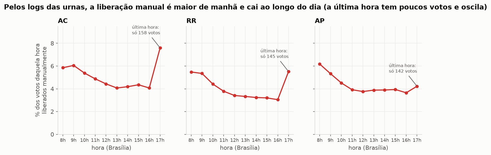
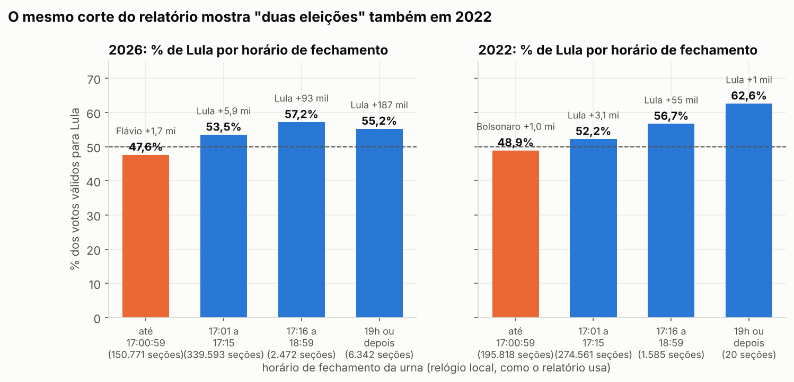
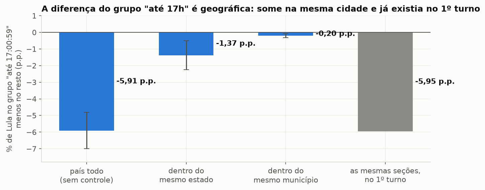
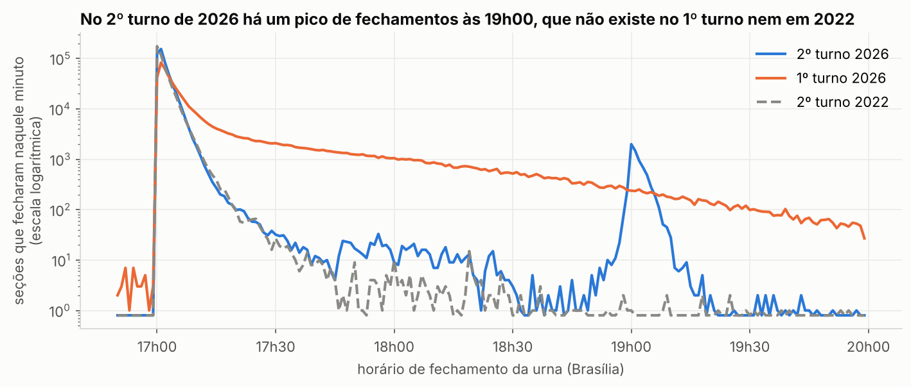
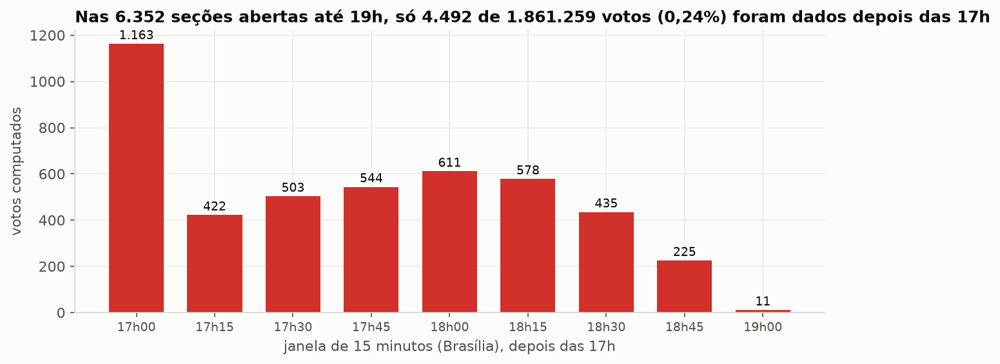
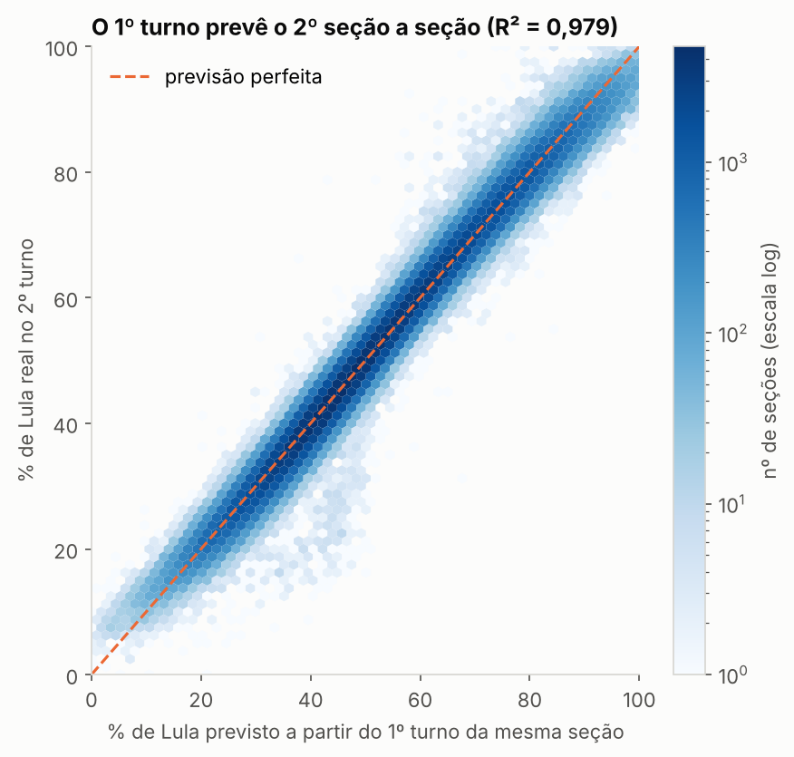
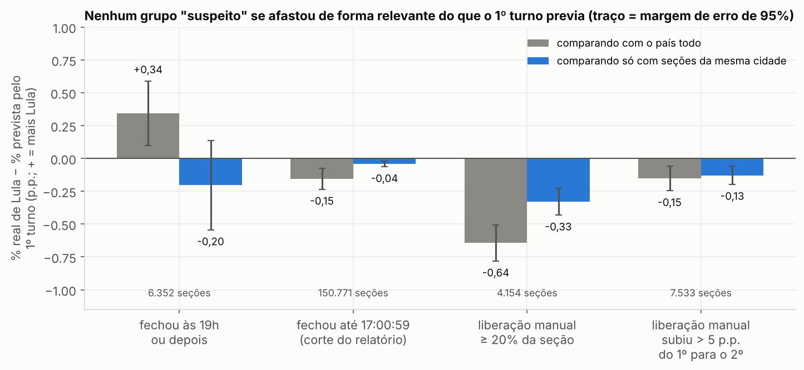

# Auditoria independente da eleição presidencial de 2026

Este repositório confere, com os dados públicos do TSE, o "Relatório Pericial Independente" que circulou
nas redes depois do 2º turno de 2026 (25/10/2026, Lula × Flávio Bolsonaro) e faz uma auditoria própria
dos dados da eleição.

Tudo pode ser refeito por qualquer pessoa. Os dados estão no repositório (ou são baixados com um comando)
e cada número vem de um script que você pode ler e rodar. O trabalho foi conferido por **cinco revisões
independentes** que recalcularam os números sem usar o nosso código; os erros que elas acharam foram
corrigidos (ver [seção 5](#5-problemas-encontrados-e-erros-corrigidos)).

> **Relatório formal — metodologia, achados e conclusão da auditoria independente:**
> [`docs/RELATORIO_DE_AUDITORIA.md`](docs/RELATORIO_DE_AUDITORIA.md)

---

## Sumário

1. [Veredito sobre o 2º turno](#1-veredito-sobre-o-2º-turno)
2. [O que o relatório afirma](#2-o-que-o-relatório-afirma)
3. [Glossário](#3-glossário)
4. [De onde veio cada dado](#4-de-onde-veio-cada-dado)
5. [Problemas encontrados e erros corrigidos](#5-problemas-encontrados-e-erros-corrigidos)
6. [As verificações, uma por uma](#6-as-verificações-uma-por-uma)
7. [Quanto cada suspeita pesa na margem](#7-quanto-cada-suspeita-pesa-na-margem)
8. [O que esta auditoria não prova](#8-o-que-esta-auditoria-não-prova)
9. [Como rodar tudo](#9-como-rodar-tudo)
10. [Mapa do repositório](#10-mapa-do-repositório)

---

## 1. Veredito sobre o 2º turno

**Os dados públicos do TSE não mostram nenhum sinal de que o resultado do 2º turno tenha sido
fabricado ou alterado.** Lula venceu por 4.430.191 votos. Nenhuma das suspeitas levantadas pelo
relatório, nem as que esta auditoria procurou por conta própria, chega perto de explicar essa margem.

Em linguagem direta:

| Pergunta | Resposta | Onde ver |
|---|---|---|
| O resultado oficial é a soma dos boletins de urna? | **Sim, exatamente**, em todas as UFs, nos dois turnos. | [6.2](#62-a-soma-dos-boletins-bate-com-o-resultado-oficial) |
| Os boletins batem com o que a urna gravou? | **Sim.** Recontando voto a voto o registro digital de cada urna (RDV): **todas as 499.178 seções com urna eletrônica do país batem exatamente** com a planilha (Lula, Flávio, brancos e nulos). O próprio relatório oficial conta 499.178 seções apuradas em urna eletrônica. | [6.4](#64-recontagem-voto-a-voto-e-logs-das-urnas) |
| As urnas usadas eram as previstas antes da eleição? | 99,4% exatamente as previstas. As trocas têm registro. Só **17 seções** (4.563 votos) não têm explicação nos dados. | [6.5](#65-as-urnas-usadas-eram-as-previstas) |
| Houve "duas eleições", antes e depois das 17h? | **Não.** O padrão vem do fuso horário e da geografia, aparece em 2022 e já existia no 1º turno nas mesmas seções. | [6.6](#66-réplica-do-relatório-duas-eleições-antes-e-depois-das-17h) |
| As urnas que ficaram abertas até 19h "fabricaram" votos? | **Não.** O fechamento às 19h é real (6.352 seções), mas os logs mostram que só **4.492 votos** (0,24%) foram dados depois das 17h nessas urnas. Elas votaram igual às vizinhas que fecharam às 17h. | [6.7](#67-as-seções-que-fecharam-às-19h) |
| Os 8,6 milhões liberados sem digital decidiram a eleição? | **Não.** A liberação é uma característica estável de cada seção e não empurra votos para Lula; onde ela é maior, Lula foi até um pouco **pior** do que o 1º turno previa. | [6.8](#68-eleitores-liberados-sem-digital) |
| O 2º turno destoa do 1º? | **Não.** O 1º turno explica 92% das diferenças entre seções da mesma cidade no 2º turno, e nenhum grupo "suspeito" se desvia. | [6.11](#611-1º-turno--2º-turno-seção-por-seção) |

**O que fica em aberto** (e não muda o resultado):
- **Por que** cerca de 1.100 locais de votação ficaram abertos até as 19h no 2º turno. Os dados mostram
  que aconteceu, mas não mostram a decisão. Isso se resolve com os atos dos TREs.
- As **17 seções** com urna sem explicação nos dados, que se resolvem com as atas dessas seções.
- **Assinaturas digitais** das urnas não foram verificadas criptograficamente.



### Resultado oficial (= soma dos boletins de urna)

| 1º turno — 05/10/2026 | Votos | % dos válidos |
|---|---|---|
| Flávio Bolsonaro (22) | 56.104.503 | 47,03% |
| Lula (13) | 53.879.538 | 45,16% |
| Augusto Cury (70) | 3.448.569 | 2,89% |
| Renan Santos (14) | 2.675.887 | 2,24% |
| Ronaldo Caiado (55) | 2.605.148 | 2,18% |
| Demais 7 candidatos | 587.143 | 0,49% |
| **Válidos** | **119.300.788** | |
| Brancos / nulos | 2.300.798 / 3.674.249 (inclui 5.246 nulos técnicos) | |
| Comparecimento | 125.275.835 (78,92% dos aptos) | |

| 2º turno — 25/10/2026 | Votos | % dos válidos |
|---|---|---|
| **Lula (13)** | **64.256.232** | **51,79%** |
| Flávio Bolsonaro (22) | 59.826.041 | 48,21% |
| **Margem** | **4.430.191** | |
| Brancos / nulos | 1.430.496 / 2.723.305 | |
| Comparecimento | 128.236.074 (80,78% dos aptos) | |

Do 1º para o 2º turno, Lula passou de 45,2% para 51,8% e Flávio de 47,0% para 48,2%. A virada aconteceu em
todas as regiões de forma parecida, e o 1º turno de cada seção prevê o 2º com precisão ([6.11](#611-1º-turno--2º-turno-seção-por-seção)).
Comparecimento por UF e a comparação estado a estado: [`PRIMEIRO_TURNO.md`](analise/PRIMEIRO_TURNO.md), seção 9.

---

## 2. O que o relatório afirma

O "Relatório Pericial Independente — Eleições 2026" (8 páginas, compartilhado no Instagram) afirma:

| # | Afirmação | Resultado da checagem |
|---|---|---|
| 1 | Nas urnas fechadas **até 17h**, Flávio venceu (52,39%); a virada veio **só depois das 17h**. | Número correto, conclusão errada ([6.6](#66-réplica-do-relatório-duas-eleições-antes-e-depois-das-17h)) |
| 2 | "Mais de 2 milhões de eleitores" votaram em seções fechadas **depois das 19h**. | Havia 2,3 milhões de **aptos**; votaram 1,86 milhão, e só 4.492 depois das 17h ([6.7](#67-as-seções-que-fecharam-às-19h)) |
| 3 | **8.632.488** liberados **sem biometria**, quase o dobro da margem. | Número correto, conclusão não se sustenta ([6.8](#68-eleitores-liberados-sem-digital)) |
| 4 | **106 seções com 100% para Lula** contra **4 para Flávio**. | Número correto; é voto regional, como em 2022 ([6.9](#69-seções-quase-unânimes)) |
| 5 | Teste da **Lei de Benford** (resultado não mostrado). | Os dois candidatos se comportam igual a uma eleição honesta simulada ([6.10](#610-lei-de-benford)) |
| 6 | Dados "**trancados**" por 72 horas. | Parcialmente: os arquivos estavam no servidor em ~1 dia, mas o catálogo os listou só em 27/10 ([6.12](#612-dados-trancados-por-72-horas)) |
| 7 | Afirmações políticas e jurídicas (decisões de ministros, passaportes, PF, reações internacionais). | Não estão nos dados; não avaliadas |

---

### Por que o relatório errou, se os números dele estão certos

Refazendo as contas, **todos os números do relatório se reproduzem**. O erro está na interpretação:

1. **Leu o relógio local como se fosse Brasília.** A urna grava a hora do estado onde está (ver
   [problema 1](#problemas-nos-dados)). As urnas do Acre, do Amazonas e do Centro-Oeste, que fecharam às 17h de
   Brasília, aparecem como "15h" ou "16h" e caíram no grupo "fechou antes das 17h". São regiões pró-Flávio, e o grupo
   pareceu "outra eleição".
2. **Não usou grupo de controle.** O mesmo corte em 2022 dá o mesmo padrão, e as mesmas seções já votavam assim no
   1º turno de 2026.
3. **Misturou regiões.** Comparou o país inteiro de uma vez. Comparando só seções da mesma cidade, as diferenças somem.
4. **Comparou grandezas que não se comparam.** 8,6 milhões de liberados contra 4,4 milhões de margem só faria
   sentido se todos tivessem votado no mesmo candidato. Não votaram.
5. **Trocou aptos por votantes.** Os "mais de 2 milhões" das seções das 19h são eleitores aptos; votaram 1,86 milhão,
   e só 4.492 depois das 17h.
6. **Usou testes inadequados e não mostrou o resultado** (Benford no 1º dígito).

O que o relatório apontou de real: cerca de 1.100 locais de votação ficaram abertos até as 19h no 2º turno. É uma
pergunta legítima (por quê?), que se responde com os atos dos TREs, e os dados mostram que isso não alterou o resultado.

## 3. Glossário

| Termo | O que significa |
|---|---|
| **Seção** | Uma "mesa" de votação: uma sala, uma urna, algumas centenas de eleitores. O Brasil tem cerca de 499 mil. |
| **Local de votação** | O prédio (geralmente uma escola) onde ficam várias seções. |
| **BU (Boletim de Urna)** | O resultado que a urna imprime e grava ao final da votação, com o total de cada candidato. |
| **BWeb** | A planilha do TSE com o conteúdo de **todos** os BUs. |
| **RDV (Registro Digital do Voto)** | Arquivo da urna com **cada voto** digitado, embaralhado (sem dizer quem votou). Permite recontar. |
| **Log da urna** | Diário automático da urna, com hora de cada evento (eleitor liberado, voto computado, erro…). |
| **Aptos / comparecimento** | Quem podia votar / quem votou. |
| **% Lula** | Neste trabalho, salvo aviso: votos de Lula ÷ (Lula + Flávio). |
| **Margem** | Votos de Lula − votos de Flávio: **4.430.191**. |
| **Saldo** | Votos de Lula − votos de Flávio **dentro de um grupo** de seções. |
| **Liberação manual** | Quando a digital do eleitor falha 4 vezes e o mesário libera por outro caminho. É o número que o relatório chama de "sem biometria" (8,6 milhões). Não confundir com quem **não tem** biometria cadastrada (outra linha do BU). |
| **Urna de contingência** | Urna reserva, preparada antes, que substitui uma urna com defeito. |
| **Correspondência esperada** | Lista publicada pelo TSE na véspera dizendo qual urna (e qual "carga" de software) vai em cada seção. |
| **Hash SHA-512** | "Impressão digital" de um arquivo: se um byte muda, o hash muda. Prova que o arquivo é o mesmo que foi publicado. |
| **Horário local × Brasília** | A urna grava a hora no fuso **do lugar**. No Acre, 17h de Brasília aparece como 15h. |
| **p.p. (pontos percentuais)** | Diferença entre porcentagens: de 50% para 52% são 2 p.p. |
| **Resíduo** | Diferença entre o resultado real de uma seção e o que se previa para ela a partir do 1º turno. |
| **Comparar "dentro do município"** | Comparar só seções da mesma cidade, para que diferenças entre regiões não confundam o resultado. |
| **Margem de erro de 95% / EP** | Faixa onde o valor verdadeiro provavelmente está. EP = erro-padrão; ±1,96 EP dá a margem de 95%. |

---

## 4. De onde veio cada dado

Tudo vem do **Portal de Dados Abertos do TSE** (<https://dadosabertos.tse.jus.br>) e do servidor de
arquivos do TSE (`cdn.tse.jus.br`). Baixado em 29/10/2026.

| # | Dado | Conteúdo | Origem | No repositório | Tamanho | Conferência |
|---|---|---|---|---|---|---|
| A | **BUs do 2º turno 2026** (BWeb, todos os cargos) | Todas as seções: votos, horários, liberações | [Resultados 2026 – Boletim de Urna](https://dadosabertos.tse.jus.br/dataset/resultados-2026-boletim-de-urna) | `dados/tse/2026/boletim_urna/2turno/` | 138 MB | `.sha512` oficial 28/28 ✅ |
| B | **BUs do 1º turno 2026** (todos os cargos) | Idem, 1º turno | mesmo link | só os `.sha512` (os .zip têm 4,8 GB) | — | `.sha512` oficial 28/28 ✅ |
| C | **Só as linhas de Presidente**, 1º e 2º turno 2026 e 2º turno 2022 | Extraídas byte a byte de A, B e E | `scripts/extrair_presidente.py` | `dados/tse/2026/presidente/`, `dados/tse/2022/presidente/` | 406 MB | `MANIFESTO.csv` liga cada arquivo ao .zip oficial e ao hash do TSE ✅ |
| D | **Correspondências esperadas**, 2º turno | Urna e carga previstas por seção + urnas de contingência, geradas em 24/10/2026 às 12:31 | [Correspondências esperadas](https://dadosabertos.tse.jus.br/dataset/resultados-2026-correspondencias-esperadas-e-efetivadas-2-turno) | `dados/tse/2026/correspondencias/2turno/` | 36 MB | `.sha512` oficial 28/28 ✅ |
| E | **BUs do 2º turno 2022** | Grupo de controle | [Resultados 2022 – Boletim de Urna](https://dadosabertos.tse.jus.br/dataset/resultados-2022-boletim-de-urna) | `dados/tse/2022/boletim_urna/2turno/` | 67 MB | `.sha512` oficial 28/28 ✅ |
| F | **Arquivos originais das urnas** de AC, RR e AP | Por urna: BU digital, imagem do BU impresso, RDV, log, assinatura | [Arquivos transmitidos para totalização](https://dadosabertos.tse.jus.br/dataset/resultados-2026-arquivos-transmitidos-para-totalizacao) | `dados/tse/2026/arquivos_urna/2turno/partes/` (pedaços de 90 MB) | 1,2 GB | sem hash oficial; `MANIFESTO.csv` próprio ⚠️ |
| G | **RDV e logs das demais UFs** | Lidos direto do servidor, sem baixar o pacote inteiro (download parcial) | mesmo link de F | resultados em `dados/derivados/` | — | conferidos contra a BWeb |
| H | **Resultado oficial** (Relatório Resultado da Totalização) | PDF assinado, Brasil e cada UF, 1º e 2º turnos | `cdn.tse.jus.br/.../Relatorio_Resultado_Totalizacao_2026_BR.zip` | `dados/tse/2026/totalizacao/` | 0,5 MB | sem hash oficial ⚠️ |
| I | **Tabelas prontas** | Uma linha por seção, logs das seções tardias, recontagem RDV, locais de votação | geradas pelos scripts | `dados/derivados/` | ~40 MB | regeneráveis |

Também registramos o que o servidor informa sobre a data dos arquivos (`SERVIDOR.csv`) e quando
o catálogo do portal os listou (`CATALOGO.csv`), em `dados/tse/2026/boletim_urna/2turno/`.

---

## 5. Problemas encontrados e erros corrigidos

### Problemas nos dados

| # | Problema | Como resolvi |
|---|---|---|
| 1 | O horário de fechamento está no **relógio local** da urna. No Acre e no oeste do Amazonas, 17h de Brasília aparece como 15h; em MT, MS, RO, RR e no resto do AM, como 16h; em Fernando de Noronha, como 18h. | Converti por município. **Três provas** ([`FUSO.md`](analise/FUSO.md)): (1) as urnas abrem às 06h no AC, 07h no Norte/Centro-Oeste e 08h no resto, ou seja, todas às 8h de Brasília; (2) nenhum boletim chegou ao TSE (relógio do servidor, em Brasília) antes das 17h05, e o menor intervalo entre "fechou" e "chegou" é exatamente 2h no AC, 1h no Norte/Centro-Oeste e 0h no resto; (3) o log de cada urna mostra o operador digitando a hora à mão na preparação (as urnas não têm internet). O exterior ficou fora da conversão. **É a origem do principal erro do relatório.** |
| 2 | O BU do 2º turno de **Roraima** não aparecia no catálogo; só o `.sha512`. | Baixei pela URL direta. Hash conferido. |
| 3 | Os **BUs do 2º turno sumiram do catálogo** entre a 1ª e a 2ª consulta (29/10). Os arquivos continuam no servidor, iguais. | Registrado em `CATALOGO.csv`. Não sabemos o motivo. |
| 4 | Os **arquivos originais das urnas** do 2º turno não estão no catálogo e não têm hash oficial. | Baixei pela URL padrão e registrei tamanho, SHA-512, data e ETag em `MANIFESTO.csv`. |
| 5 | GitHub não aceita arquivos acima de 100 MB. | Pacotes das urnas em partes de 90 MB (`scripts/remontar_arquivos_urna.sh` remonta e confere). BUs do 1º turno: versionadas só as linhas de Presidente. |
| 6 | Em 2022 o campo de biometria tem outro nome e o código do cargo vem entre aspas. | Leitor aceita os dois formatos. |
| 7 | O código de carga vem **partido em duas colunas** no BU; a lista prévia **perde zeros à esquerda**. | Juntei e completei para 24 dígitos. |
| 8 | O "leia-me" diz que o log é 7z; é **zip**. Urnas substituídas trazem o log anterior **dentro** de outro zip. | O leitor abre os dois níveis. |
| 9 | O resultado oficial só existe em **PDF**. | Extraído com `pdftotext`. |
| 10 | Seções do exterior sem eleitores presentes não aparecem na BWeb (2 no 2º turno, 1 no 1º). | Explica 499.205 seções com voto × 499.207 em funcionamento no oficial. |
| 11 | 29 seções do exterior não têm horário: foram apuradas em **cédula** (Sistema de Apuração). | O relatório oficial confirma: "29 seções apuradas pelo SA". |
| 12 | No 1º turno, o nº 28 teve 5.246 votos que não aparecem no resultado oficial. | São exatamente os 5.246 "votos nulos técnicos" do oficial (registro anulado). |

### Erros meus que os revisores encontraram e que foram corrigidos

Pedi a cinco revisores independentes (recontagem do zero, estatística, código dos logs, leitura adversária
e investigação das seções das 19h) que tentassem derrubar o trabalho. O que acharam:

| Erro | Correção |
|---|---|
| Fuso do **oeste do Amazonas** (UTC−5) e de **Fernando de Noronha** (UTC−2) ignorados; criava 556 seções "fechadas antes das 17h" que não existiam. | Fuso por município. |
| Faixa "até 17:00:59" com erro de 1 segundo num script (3.199 seções na faixa errada). | Uma função única de faixas para todos os scripts. |
| Biometria: eu usava "correlação ≈ 0" como prova de "sem relação". Correlação baixa não prova efeito pequeno. | Agora: inclinação com margem de erro, pior caso aritmético e testes contra o 1º turno ([6.8](#68-eleitores-liberados-sem-digital)). |
| Seções das 19h: eu citava só a comparação favorável (−0,17 p.p.); na nacional é +0,34 p.p. | Todas as formas lado a lado, limite máximo de efeito, logs dos votos depois das 17h ([6.7](#67-as-seções-que-fecharam-às-19h)). |
| Chamei de "pior caso" valores que não eram pior caso (efeito líquido, saldo). | Gráfico 8 refeito, todos os valores calculados pelo código. |
| Atribuí o grupo "até 17h" a "seções menores"; o tamanho quase não explica. | Decomposição por estado e município + comparação com o 1º turno ([6.6](#66-réplica-do-relatório-duas-eleições-antes-e-depois-das-17h)). |
| O leitor de logs dependia da ordem de eventos no mesmo segundo (27 falsas divergências). | Classificação pela sessão inteira do eleitor: 100% de concordância. |
| 120 urnas "sem registro prévio" exageradas: a maioria foi carregada **depois** que a lista foi gerada. | Categorias separadas; sobram 17 sem explicação ([6.5](#65-as-urnas-usadas-eram-as-previstas)). |
| Comparação da biometria com 2022 usava um campo com definição possivelmente diferente. | Retirada. |
| "R² = 97,9% de precisão": R² não é precisão, e a maior parte vem da diferença entre regiões. | Agora o número principal é o de dentro do município (~0,92). |

---

## 6. As verificações, uma por uma

Cada verificação traz **a pergunta**, **como foi calculado** e **o resultado**. Os detalhes completos
estão nos arquivos `analise/*.md` indicados.

### 6.1 Os arquivos são os originais do TSE?

**Como:** calculei o SHA-512 de cada arquivo baixado e comparei com o `.sha512` publicado pelo TSE.
**Resultado:** 112 de 112 conferem. (Limite: o hash vem do mesmo servidor; prova que o download está
íntegro, não que o servidor é confiável. A conferência com o PDF oficial e com os arquivos das urnas,
abaixo, cobre isso de outra forma.)

### 6.2 A soma dos boletins bate com o resultado oficial?

**Como** (`analise/totalizacao.py`): somei, de todos os BUs, seções, aptos, comparecimento, brancos, nulos
e votos de cada candidato, por UF e no Brasil, e comparei com o PDF oficial do TSE.

**Resultado:** votos, brancos, nulos e comparecimento batem **exatamente** em 29 de 29 regiões (27 UFs +
exterior + Brasil), nos dois turnos. As únicas diferenças são 1–2 seções do exterior sem nenhum votante
(problema 10). Resultado oficial do 2º turno: Lula **64.256.232**, Flávio **59.826.041**, assinado às
**23h28 do dia 25/10**. Detalhe: [`analise/TOTALIZACAO.md`](analise/TOTALIZACAO.md).

### 6.3 Cada boletim faz sentido sozinho?

**Como** (`analise/consistencia.py`): regras aplicadas a cada um dos 499.205 BUs (538.946 pares seção ×
cargo).

| Regra | Violações |
|---|---|
| aptos = comparecimento + abstenções | 0 |
| comparecimento ≤ aptos | 0 |
| soma de todos os votos = comparecimento | 0 |
| liberados ≤ comparecimento | 0 |
| abertura < encerramento ≤ impressão do BU | 0 (fora as 29 seções de cédula, sem horário) |
| urna abriu no dia da eleição | 0 |
| comparecimento de Presidente **menor** que o de Governador | 0 (é sempre maior ou igual: quem vota em trânsito só vota para Presidente) |
| BU recebido pelo TSE antes de impresso pela urna | 8 seções, diferença de no máximo 52 segundos (relógio da urna levemente adiantado) |
| urna preparada no dia da eleição | 5 (urnas substituídas antes da abertura; abriram atrasadas) |

Detalhe: [`analise/CONSISTENCIA.md`](analise/CONSISTENCIA.md).

### 6.4 Recontagem voto a voto e logs das urnas

**A pergunta:** a planilha do TSE é fiel ao que cada urna registrou?

**Recontagem pelo RDV** (`analise/recontagem_rdv.py` e `recontagem_rdv_nacional.py`): o RDV guarda cada voto
digitado. Escrevemos um leitor do formato da urna (ASN.1/DER), contamos os votos de Presidente um a um e
comparamos com a planilha. Para AC, RR e AP também conferimos o BU digital (`bu.dat`) e o código de
carga gravado nele.

| Recontagem pelo RDV | Resultado |
|---|---|
| Seções com urna eletrônica recontadas (Brasil + exterior) | **499.178** |
| RDV idêntico à planilha (Lula, Flávio, brancos e nulos) | **499.178 de 499.178** |
| Lula / Flávio somando os RDVs | 64.255.787 / 59.825.688 |
| Diferença para o oficial | 445 / 353: exatamente os votos das 27 seções do exterior apuradas em **cédula**, que não têm RDV de urna |
| AC, RR e AP: BU digital (`bu.dat`) e código de carga = planilha | 5.703 de 5.703 |

Cada RDV foi lido direto do pacote oficial do TSE, baixando só aquele arquivo (download parcial).

**Logs e BU impresso de AC, RR e AP** (`analise/logs_urna.py`, `analise/imagem_bu.py`; 5.703 urnas):

| Verificação | AC | RR | AP |
|---|---|---|---|
| BU impresso = planilha (votos, brancos, nulos, aptos, totais) | 2270/2270 | 1519/1519 | 1914/1914 |
| Votos no log = comparecimento | 2270/2270 | 1519/1519 | 1914/1914 |
| Liberações (digital, manual, sem biometria cadastrada) no log = BU | 2270/2270 | 1519/1519 | 1914/1914 |
| Voto registrado depois do fechamento | 0 | 0 | 0 |

**Como funciona a liberação manual, segundo os logs:** a digital do eleitor falha 4 vezes → a urna pede um
dado pessoal → se não confere, recusa (1.383 recusas; 338 eleitores saíram sem votar depois disso) → a urna
pede a digital do mesário. Em 71% das liberações o mesário é identificado pelo nome; nas demais, a digital
do mesário é capturada mas não associada a um nome. Não é "simples digitação do ano de nascimento" (isso é
o caminho de quem **não tem** biometria cadastrada, outra linha do BU).



Detalhes: [`RECONTAGEM_RDV.md`](analise/RECONTAGEM_RDV.md), [`RECONTAGEM_RDV_NACIONAL.md`](analise/RECONTAGEM_RDV_NACIONAL.md),
[`LOGS.md`](analise/LOGS.md), [`IMAGEM_BU.md`](analise/IMAGEM_BU.md).

### 6.5 As urnas usadas eram as previstas?

**Como** (`analise/correspondencia.py`): para cada seção, comparei a urna e o código de carga do BU com a
lista publicada em 24/10 às 12:31. Datas de carga convertidas para Brasília. Cada seção cai em uma categoria:

| Categoria | Seções | Votos | Saldo de Lula |
|---|---|---|---|
| 1. urna e carga exatamente as previstas | 496.138 | 127.447.547 | +4.401.710 |
| 2. urna prevista, carga diferente da lista | 9 | 2.467 | −55 |
| 3. urna de contingência da lista, com a carga da lista | 2.641 | 686.899 | +21.744 |
| 4. urna de contingência da lista, recarregada | 258 | 63.989 | +1.902 |
| 5. urna fora das listas, carregada **depois** que a lista foi gerada | 45 | 12.032 | +1.968 |
| 6. urna fora das listas, mesmo cartão de carga da urna prevista | 59 | 15.027 | +2.230 |
| **7. urna fora das listas, sem explicação nos dados** | **16** | **4.275** | **−19** |
| 8. seção fora da lista: exterior, apurada em cédula | 27 | 831 | +92 |
| 9. seção fora da lista, urna de contingência da lista | 11 | 2.719 | +558 |
| **10. seção fora da lista, urna fora das listas** | **1** | **288** | **+61** |

As categorias 2, 4, 5, 6 e 9 têm explicação provável nos próprios dados, mas pedem confirmação nas atas.
**Sem explicação: 17 seções, 4.563 votos, saldo de +42 para Lula.** Lista: [`secoes_para_documentar.csv`](analise/secoes_para_documentar.csv).
Detalhe: [`analise/CORRESPONDENCIA.md`](analise/CORRESPONDENCIA.md).

### 6.6 Réplica do relatório: "duas eleições" antes e depois das 17h

**Como** (`analise/verificar_relatorio.py`): separei as seções pelo horário de fechamento **como gravado pela
urna** (relógio local), nas faixas do relatório, e somei os votos.

**Os números do relatório saem exatos:** até 17:00:59, 150.771 seções e Flávio com 52,39%; de 17:01 a
17:15, 339.593 seções, 88.071.750 eleitores e 53,46% para Lula.

**Por que a conclusão está errada:**

1. **O mesmo corte dá "duas eleições" em 2022** (Bolsonaro +1,0 mi "até 17h", Lula vira depois):



2. **É geografia, não horário.** Os estados a oeste (relógio marca 15h/16h quando são 17h em Brasília) são
   21% das seções do grupo e 83% da vantagem de Flávio nele. Comparando só seções do mesmo estado, a
   diferença cai de −5,9 para −1,4 p.p.; do mesmo município, para −0,2 p.p. E **as mesmas seções já votavam
   assim no 1º turno** (−5,95 p.p.):



3. **17:01–17:15 não é prorrogação.** Quem está na fila às 17h vota; a urna fecha depois do último. Essa
   faixa tem 68% das seções do país (73% em horário de Brasília).

### 6.7 As seções que fecharam às 19h

**O que é real:** no 2º turno, **6.352 seções** (em horário de Brasília) fecharam às 19h ou pouco depois: 1.993
no minuto 19:00 exato e 6.319 entre 19:00 e 19:15. O formato é o de um horário-limite marcado (não de fila),
e elas se concentram em **1.131 locais de votação**, 313 deles inteiros, sobretudo nas capitais (Rio 1.978,
São Paulo 1.481, Salvador 730). Isso não aparece no 1º turno (que teve fechamentos tardios espalhados,
por fila) nem em 2022.



**O que os dados mostram sobre os votos dessas seções:**

- **Quase ninguém votou no horário extra.** Lendo o log de cada uma das 6.352 urnas (direto do servidor do
  TSE), só **4.492 de 1.861.259 votos (0,24%)** foram computados depois das 17h; 3.885 urnas não tiveram
  nenhum voto depois das 17h15. O total de votos no log bate com o BU em 100% das urnas.



- **Votaram como as vizinhas.** Comparando com seções **do mesmo local de votação** que fecharam às 17h:
  diferença de −0,06 p.p. na % de Lula e +0,03 p.p. no comparecimento. Comparecimento delas: 80,6%
  (país: 80,8%).
- **Votaram como no próprio 1º turno.** Lula subiu +3,25 p.p. nelas e +3,20 p.p. nas demais seções das mesmas
  cidades. No pior cenário estatístico, o desvio vale no máximo **24.498 votos** (0,6% da margem).
- **Mesmo anulando todas** essas seções, Lula venceria por 4.244.467 votos. No RJ, que tem mais seções
  tardias, Flávio venceu nelas (45,8% Lula).
- O "mais de 2 milhões de eleitores" do relatório só bate contando os **aptos** (2,31 mi); votaram 1,86 mi.

**O que os dados não dizem:** por que esses locais ficaram abertos até as 19h. Detalhe:
[`LOGS_TARDIAS.md`](analise/LOGS_TARDIAS.md), [`RESULTADOS.md`](analise/RESULTADOS.md) seção 4.

### 6.8 Eleitores liberados sem digital

**O número confere:** 8.632.488 (6,73% do comparecimento). Comparar com a margem só faria sentido se esses
eleitores tivessem votado em bloco num candidato. Testei de quatro formas:

**1. Pior caso aritmético:** se em cada seção todo liberado tivesse votado em Lula e fosse retirado, Flávio
venceria por 4,19 milhões. Esse cenário exige um comportamento que os testes abaixo descartam.

**2. Inclinação** (quanto a % de Lula muda quando a liberação muda), estimando como votaram os liberados:

| Comparando… | % de Lula entre os liberados (estimativa) | Margem sem os liberados (limite de 95%) |
|---|---|---|
| o país todo | 78% | −2,68 mi |
| dentro do estado | 68% | −0,23 mi |
| **dentro do município** | **54%** | **+2,55 mi** |

Liberação e voto em Lula são ambos maiores em certas regiões (Nordeste, interior). Comparar o país todo
atribui à liberação um efeito que é da geografia (a "falácia ecológica"). A comparação justa é entre seções
da mesma cidade: aí os liberados votam quase como os demais.

**3. Contra o 1º turno (o teste mais forte):** dado como a própria seção votou no 1º turno, **mais
liberação vem com menos Lula** do que o previsto (−0,37 p.p. a cada 10 p.p. de liberação), e o **aumento**
da liberação entre os turnos não tem efeito (+0,01 p.p., margem de erro ±0,03). Se a liberação fosse usada
para pôr votos em Lula, apareceria o contrário.

**4. Estabilidade:** a taxa de cada seção se repete entre os turnos (correlação 0,82) e é parecida no
Nordeste (7,2%) e no resto do país (6,6%). É característica da seção (idade do eleitorado, digitais
gastas, leitor biométrico), não algo que surgiu no 2º turno.

### 6.9 Seções quase unânimes

| Eleição | 100% Lula | 100% adversário | >90% Lula | >90% adversário |
|---|---|---|---|---|
| 2º turno 2026 | 106 | 4 | 6.816 | 378 |
| 1º turno 2026 | 81 | 8 | 6.005 | 713 |
| 2º turno 2022 | 143 | 4 | 9.433 | 213 |

Os números do relatório conferem. 75% das seções com mais de 90% para Lula estão em MA, BA, PI, PE e CE,
onde ele teve ~69%. Quando a média de uma região é 70%, é natural ter muitas seções acima de 90%.

### 6.10 Lei de Benford

| Teste | Resultado |
|---|---|
| 1º dígito | Lula e Flávio "falham" igual (dígito 1 em ~61%). Esperado: o voto de um candidato numa seção fica entre 100 e 199 em 61% dos casos. Inadequado para votos por seção (Deckert, Myagkov & Ordeshook, 2011). |
| 2º dígito | Real: média 3,86 (Lula) e 3,97 (Flávio). **Simulação de uma eleição honesta** com o mesmo tamanho de seção: 3,87. O real é igual ao honesto. |
| Último dígito (Beber & Scacco) | Uniforme para os dois (qui-quadrado 5,0 e 12,4; limite 16,9). Nenhum sinal de números "inventados". |

### 6.11 1º turno × 2º turno, seção por seção

**A ideia:** a mesma seção, com os mesmos eleitores, votou duas vezes em três semanas. Se urnas tivessem
sido manipuladas no 2º turno, essas seções fugiriam do padrão que o 1º turno indicava.

**Como** (`analise/primeiro_turno.py`): para cada seção, um modelo prevê a % de Lula no 2º turno a partir dos
votos de cada candidato, brancos/nulos e abstenção do 1º turno. Seis formas do modelo (linear e logit;
nacional, por estado, por município; com e sem peso pelo tamanho). Depois, compara-se o desvio médio
entre grupos de seções, com margem de erro agrupada por município.



O 1º turno explica 97,9% das diferenças entre seções no país e **91,6% comparando só seções da mesma
cidade**. Erro típico: 2,2 a 2,5 p.p.



Nenhum grupo "suspeito" se desvia de forma relevante. As seções das 19h variam entre −0,20 e +0,35 p.p.
conforme a forma do modelo; as de muita liberação manual ficam **abaixo** do previsto para Lula em todas
as formas. Seções muito fora do padrão (mais de 4 desvios): 747, divididas entre os dois lados; somando só
os desvios a favor de Lula, 11.896 votos.

**Limites deste teste** (por isso ele não é o único): não detecta manipulação igual em todas as seções
(coberta pela soma oficial e pelo RDV), nem manipulação que tenha ocorrido também no 1º turno, nem de um
município inteiro na comparação "dentro do município" (a nacional pega). Detalhe:
[`PRIMEIRO_TURNO.md`](analise/PRIMEIRO_TURNO.md).

Resultado do 1º turno (soma dos BUs = oficial): Flávio 47,03%, Lula 45,16%, Augusto Cury 2,89%, Renan
Santos 2,24%, Ronaldo Caiado 2,18%.

### 6.12 "Dados trancados por 72 horas"

| Evento | Quando |
|---|---|
| Resultado oficial assinado (totalização) | 25/10, 23h28 |
| Planilha BWeb gerada | 26/10, 07h42 |
| BWeb no servidor (`Last-Modified`) | 26/10, ~09h00 de Brasília (`SERVIDOR.csv`) |
| Arquivos originais das urnas no servidor | 26/10, entre 15h26 e 17h01 de Brasília (`MANIFESTO.csv`) |
| BWeb listada no catálogo do portal | 27/10, ~19h, no relógio do catálogo, sem fuso informado (`CATALOGO.csv`) |

Os arquivos existiam no servidor cerca de 1 dia depois da eleição, mas só apareceram no catálogo (onde as
pessoas procuram) cerca de 2 dias depois, e em 29/10 tinham saído do catálogo de novo. A crítica de que os
dados demoraram a ficar **acessíveis** tem algum fundamento; a de que estavam escondidos para alterá-los
não: o BU de cada urna é impresso e afixado na seção na noite da eleição, e os arquivos batem com o
resultado assinado às 23h28 do próprio dia 25.

---

## 7. Quanto cada suspeita pesa na margem

Todos os valores abaixo são calculados pelo código (`analise/graficos.py`, gráfico 8).

| Suspeita | Pior caso | % da margem |
|---|---|---|
| Anular todas as seções que fecharam às 19h | 185.724 votos | 4,2% |
| Seções das 19h: maior desvio estatístico plausível vs. 1º turno | 24.498 | 0,6% |
| Seções das 19h: todos os votos dados depois das 17h | 4.492 | 0,1% |
| Seções muito fora do padrão 1º→2º turno (só desvios pró-Lula) | 11.896 | 0,3% |
| Seções com urna sem explicação nos dados (todos os votos) | 4.563 | 0,1% |
| Liberação manual (limite de 95%, comparando dentro do município) | a margem cairia para 2,55 mi | — |

---

## 8. O que esta auditoria não prova

- **Assinaturas digitais** das urnas (`*.vsc`) não foram verificadas criptograficamente. Elas provariam
  que os arquivos foram gerados por urnas oficiais. É o próximo passo técnico.
- **Logs e BU impresso** foram lidos para AC, RR, AP e para todas as seções das 19h; não para todas as urnas.
- **Nenhuma análise de dados prova que o software da urna é honesto.** Isso cabe aos testes públicos de
  segurança e à fiscalização. O que os dados mostram é que BU, RDV, logs e resultado oficial contam a
  mesma história.
- **Por que** houve fechamento às 19h e o que explica as 17 urnas sem registro: exige atos dos TREs e atas.
- As **afirmações políticas e jurídicas** do relatório (Capítulo 6) não estão nos dados do TSE.
- Os testes estatísticos estimam efeitos com margem de erro; os testes de contagem (soma oficial, RDV,
  logs) são exatos.

---

## 9. Como rodar tudo

Precisa de Python 3 e `pdftotext` (pacote `poppler-utils`).

```bash
git clone https://github.com/JardaCoder/elections-brazil.git
cd elections-brazil
pip install pandas numpy tabulate matplotlib

scripts/remontar_arquivos_urna.sh       # junta os pacotes das urnas de AC, RR e AP

cd analise
python3 totalizacao.py                  # 6.2  soma dos BUs × resultado oficial
python3 fuso.py                         # 5    prova de que a urna grava o horário local
python3 consistencia.py                 # 6.3  regras em cada BU
python3 recontagem_rdv.py AC RR AP      # 6.4  recontagem voto a voto (local)
python3 imagem_bu.py AC RR AP           # 6.4  BU impresso × planilha
python3 logs_urna.py AC RR AP           # 6.4  log da urna × BU
python3 correspondencia.py              # 6.5  urnas usadas × previstas
python3 verificar_relatorio.py          # 6.6–6.10 réplica e testes do relatório
python3 primeiro_turno.py               # 6.11 1º × 2º turno
python3 graficos.py                     # gráficos em docs/graficos/

# Leem direto do servidor do TSE (download parcial; demoram):
python3 logs_tardias.py --refazer       # 6.7  logs das 6.352 seções das 19h (~20 min)
python3 recontagem_rdv_nacional.py      # 6.4  RDV de todas as seções do país (~2 h)
```

Para baixar outros dados: `python3 scripts/baixar_dados_tse.py` lista os conjuntos.
Para refazer a extração de Presidente a partir dos .zip oficiais: `python3 scripts/extrair_presidente.py`.

---

## 10. Mapa do repositório

```
README.md                          este arquivo
docs/RELATORIO_DE_AUDITORIA.md     relatório formal: escopo, metodologia, achados, limitações e parecer
analise/
  RESULTADOS.md                    réplica e testes do relatório (6.6 a 6.10)
  PRIMEIRO_TURNO.md                1º × 2º turno (6.11)
  TOTALIZACAO.md                   soma dos BUs × oficial (6.2)
  FUSO.md                          prova de que a urna grava o horário local (problema 1)
  CONSISTENCIA.md                  regras por BU (6.3)
  RECONTAGEM_RDV.md                recontagem voto a voto AC/RR/AP (6.4)
  RECONTAGEM_RDV_NACIONAL.md       recontagem voto a voto, Brasil (6.4)
  IMAGEM_BU.md, LOGS.md            BU impresso e logs × planilha (6.4)
  CORRESPONDENCIA.md               urnas usadas × previstas (6.5)
  LOGS_TARDIAS.md                  votos depois das 17h nas seções das 19h (6.7)
  secoes_para_documentar.csv       seções com urna/carga fora da lista
  secoes_fora_do_padrao_1t_2t.csv  seções muito fora do padrão entre turnos
  carregar.py                      lê os dados; fuso por município; faixas de horário
  estatistica.py                   modelos, comparações e margem de erro
  *.py                             um script por verificação (ver seção 9)
scripts/
  baixar_dados_tse.py              baixa dados do TSE e confere o hash
  extrair_presidente.py            separa as linhas de Presidente dos .zip oficiais
  remontar_arquivos_urna.sh        junta as partes dos pacotes das urnas
docs/graficos/                     gráficos deste README
dados/
  tse/2026/boletim_urna/2turno/    BWeb 2º turno (todos os cargos) + SERVIDOR.csv + CATALOGO.csv
  tse/2026/boletim_urna/1turno/    só os .sha512 (os .zip: baixar)
  tse/2026/presidente/             linhas de Presidente, 1º e 2º turno, + MANIFESTO.csv
  tse/2026/correspondencias/       urnas previstas por seção
  tse/2026/arquivos_urna/2turno/   arquivos originais das urnas AC/RR/AP (partes + MANIFESTO.csv)
  tse/2026/totalizacao/            resultado oficial (PDF)
  tse/2022/                        2º turno 2022 (controle)
  derivados/                       tabelas prontas geradas pelos scripts
```

---

*Análise independente, sem vínculo com o TSE, partidos ou autores do relatório. Achou um erro? Abra uma
issue com o script e o resultado: a ideia é justamente que qualquer pessoa possa conferir.*
